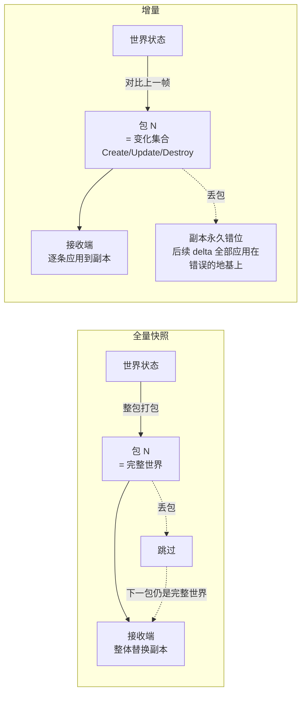

# 第5章 对象复制

> **小节地图**：§5.1–5.4 + §5.7——本篇正文；§5.5 RPC / §5.6 自定义方案——不立篇（枝节，§5.7 总结已覆盖其结论）；
> §9.1 对象范围与相关性（第 9 章）并入本册 §5.3 之后的「规模是开关」一节；§9.2–9.4 见 [[第9章 可扩展性]]。
> 底层依赖：序列化（[[第4章 对象序列化|第4章]]）。

## 0 · 原文锚点（逐条可回查）

下面每条给出「本篇小节 → 原文位置 → 该处原文逐字摘录」。摘录一字不改，
用 `kb_anchor_check.py` 可以把每条引文回查所在行；对不上就是这里错了。

| 本篇小节 | 原文位置 | 该处原文（逐字摘录） |
|---|---|---|
| §5.1 世界状态 | 05-第5章 对象复制.md L57 | 客户端收到这个状态来更新自己的世界状态。这样，客户端主机上的所有玩家最终体验了相同的世界状态 |
| §5.2 复制比序列化更苛刻：先做三步预处理 | 05-第5章 对象复制.md L65 | 复制比第 4 章讨论的序列化要求更苛刻 |
| §5.2 包标记 `PacketType` | 05-第5章 对象复制.md L85 | 为了复制对象，发送方序列化 `PT_ReplicationData` 作为数据包的第一个字节 |
| §5.2.1 `LinkingContext` 双向映射 | 05-第5章 对象复制.md L89 | 清单5.2 扩展的 LinkingContext |
| §5.2.1 递增即安全，不为理论边界造系统 | 05-第5章 对象复制.md L150 | 如果在一个游戏的持续时间中有多于 40 亿个不同的对象，那么你需要实现一个更复杂的系统 |
| §5.2.2 反面教材：`dynamic_cast` 链 | 05-第5章 对象复制.md L162 | 反面教材:用 dynamic_cast 链判断类型,再手写四字符码 |
| §5.2.2 解耦判据（游戏依赖网络，不反过来） | 05-第5章 对象复制.md L212 | 减少游戏代码和网络代码之间耦合的一种清晰的方式是使用对象创建注册表 |
| §5.2.2 `kClassId` 三件套 | 05-第5章 对象复制.md L216 | 首先，给每个类赋予一个唯一的标识符，并将其存储在名为 `kClassId` 的静态常数中 |
| §5.2.2 四字符文本是「实现定义」的 | 05-第5章 对象复制.md L218 | 在 C++ 标准中，它们被归类为依赖于实现的 |
| §5.2.2 有反射系统就别造这套 | 05-第5章 对象复制.md L362 | 对象创建注册表变成了数据类型注册表 |
| §5.2.3 一包多对象，别浪费 MTU | 05-第5章 对象复制.md L366 | 一旦主机已经标记一个数据包为 `PT_ReplicationData` 数据包 |
| §5.3 接收端三步循环 | 05-第5章 对象复制.md L459 | 销毁所有未出现在数据包中的本地数据对象 |
| §5.3 「缺席即销毁」 | 05-第5章 对象复制.md L489 | 全量快照特有的免费赠品 |
| §5.3 三步汇总（编排层注释） | 05-第5章 对象复制.md L526 | 接收端三步:**已存在 → 覆盖;不存在 → 按类 ID 创建再覆盖;本地有而包里没有 → 销毁** |
| §5.4 增量的前提是可靠传输（警告框） | 05-第5章 对象复制.md L717 | 因为互联网本身是不可靠的，所以不能简单假设接收方的世界状态是基于发送方上一次发送的数据包 |
| §5.7 规模是开关 | 05-第5章 对象复制.md L986 | 大规模的游戏没办法将所有对象的复制数据装入一个数据包 |
| §9.1 对象范围 / 相关性 | 09-第9章 可扩展性.md L42 | 在有 64 位玩家的游戏中，不需要了解（游戏世界中）几公里以外的玩家 |
| §9.1 空间法不够鲁棒（狙击步枪反例） | 09-第9章 可扩展性.md L46 | 作为相关性判断的唯一机制是不够鲁棒的 |

> **书里没写的**（本篇多处引用了原文没有的东西，读的时候别以为原文有）：
> 「全量快照每包自足因此幂等」——第 5 章没有出现「幂等」二字，这是本篇的推论；
> 「漏 delta 会永久错位」——原文没有这句判据，真正的依据是 L717 那段警告（发送方无法精确表示接收方状态）。
> 「ID 回收」只在 L150 以「你需要实现一个更复杂的系统」一句带过，原文没展开回收方案。

## 5.1 世界状态：把「同一个世界」分解成「每个对象」

§5.1 给出复制的动机：多人游戏必须让所有玩家感觉处于同一个世界——一个人开了门，范围内所有人都看见门开。实现方式是每台主机各自构建一个**世界状态**，靠交换信息保持一致。

然后是一次关键的分解：若游戏采用面向对象的对象模型，**世界状态 = 世界中所有游戏对象的状态的集合**。「同步世界」这个大问题由此坍缩为「传输每个对象的状态」——整章（乃至整本书的状态同步路线）都建立在这个分解上。

## 5.2 复制对象：标识、类型与解耦

复制 = 从一台主机向另一台传输对象状态。它在序列化之前多出**三步预处理**（§5.2）：

1. **标记数据包**：`PacketType` 枚举（`PT_Hello / PT_ReplicationData / PT_Disconnect / PT_MAX`）序列化为包的第一个字段——「别假设每个包都是复制数据」，接收端按类型分发；
2. **唯一标识对象**：让接收端知道「这是哪个对象」——已有一份就更新，没有才创建；
3. **指明对象类型**：对象不存在时，接收端得知道该 `new` 哪个类。

### 5.2.1 网络 ID：LinkingContext 的双向映射

网络 ID 的记账交给 `LinkingContext`，结构是**两张反向的哈希表**：

```
GameObject* → networkId     （发送方向：写包前查 ID）
networkId → GameObject*     （接收方向：读包后找到对象）
mNextNetworkId              （递增分配器，从 1 起）
```

- `GetNetworkId(obj, true)`：查不到且允许时**现场分配**新 ID——发送端的按需注册；
- 接收端拿到 ID 查表：有 → 反序列化覆盖；无 → 走创建流程。

原文对溢出的态度值得记住：uint32 有 40 亿个值，「一个游戏的持续时间中有多于 40 亿个对象」在绝大多数游戏里不成立——**计数器递增就是安全的**，不必为理论边界造复杂系统；真会耗尽才需要 ID 回收。

### 5.2.2 类标识：从硬编码的四大罪状到注册表

**反面教材**（清单 5.3/5.4）：`dynamic_cast` 链判断类型 → 写四字符码；接收端 `switch` → `new` 对应类。原文列了四条罪状：

| # | 罪状 | 本质 |
|---|---|---|
| 1 | 依赖 RTTI | 游戏通常**禁用** RTTI（每个多态类型都要额外存储） |
| 2 | 双向耦合 | 每加一个可复制类，**网络代码里要同时改两处**——容易忘，忘了就不同步 |
| 3 | 不可复用 | 换个游戏，复制系统里引用着旧游戏的类名，得重写 |
| 4 | 拖累测试 | 网络单元没法脱离游戏单元加载测试 |

判据一句话：**游戏代码可以依赖网络代码，网络代码几乎不依赖游戏代码。**

**正解：对象创建注册表**（§5.2.1）——把「类标识 → 创建函数」的映射从网络代码里抽出来，三方配合：

1. 每个可复制类：静态 `kClassId` + 虚函数 `GetClassId()` + 静态 `CreateInstance()`（`CLASS_IDENTIFICATION` 宏把三件套收成一行）；
2. 注册表单例：`map<kClassId, 创建函数>`，模板函数 `RegisterCreationFunction<T>()` 用编译期类型**同时**填 key 和 value——从结构上杜绝「ID 和创建函数不匹配」；
3. 游戏启动时调一次 `RegisterObjectCreation()` 填表。

原文的两个工程批注：**四字符文本是「实现定义」的**（`'RBCT'` 跨编译器不保证一致，GCC/MSVC 恰好相同——跨编译器通信前先测；它流行的理由是包转储里肉眼可读）；**有反射系统就别造这套**（`GetDataType()` 返回 `DataType`，注册表变成数据类型注册表，接收端还能顺手做通用序列化）。

这套注册表实质是**手写的定制版 RTTI**——放弃 `typeid` 的通用性，换回内存、标识符大小与跨编译器兼容性的完全控制。

### 5.2.3 一包多对象：MTU 不要浪费（§5.2.2 小节）

对象不都大，单包单对象浪费 MTU。包标记为 `PT_ReplicationData` 后，**重复「ID → classId → 数据」三元组直到流空**；接收端反序列化完一个对象，剩余字节必然是下一个对象的。**这个三元组就是 §5.3 里 `ReplicateIntoStream` 的每次迭代**。

## 5.3–5.4 全量快照与增量：世界状态复制的两种形态

### 0 统一框架：副本一致问题

§5.4 开篇给定了整个问题的前提：**每台主机都保存自己的世界状态副本**。所有方案都在回答同一个问题的两种问法：

- 全量快照回答「**状态是什么**」——每个包携带完整世界状态，接收端整体替换；
- 增量回答「**状态怎么变**」——每个包携带变化的集合，接收端在本地副本上应用变化。



两者的根本差异不在带宽，在**对历史的依赖**：全量的每一包自足，增量的每一包依赖此前所有包都已正确应用。这一条决定了它们对传输层的要求完全不同（见下文 §5.4 警告框）。

### 1 全量快照：整包世界

#### 1.1 发送端：一个三元组打包一切

§5.3 清单 5.8 的 `ReplicateWorldState` 就是全部：遍历所有对象，逐个写入流。每个对象是三元组：

```cpp
void ReplicationManager::ReplicateIntoStream(
    OutputMemoryBitStream& inStream, GameObject* inGameObject)
{
    inStream.Write(mLinkingContext->GetNetworkId(inGameObject, true)); // 网络ID
    inStream.Write(inGameObject->GetClassId());                        // 类ID
    inGameObject->Write(inStream);                                     // 对象数据
}
```

#### 1.2 接收端：三步循环 + 缺席即销毁

清单 5.9 的接收逻辑是理解全量性质的钥匙：**已存在 → 反序列化覆盖；不存在 → 按类 ID 创建再覆盖；本地有而包里没有 → 销毁**。最后一步是全量特有的免费赠品——「缺席即销毁」天然处理了对象消失，不需要显式的销毁消息。

#### 1.3 关键性质：每包自足（幂等）

全量包不携带任何「相对哪一帧而言」的信息，包的内容就是完整事实。推论有三，全部来自这一个性质：

1. **丢包零累积误差**。丢掉包 N，世界短暂停在 N-1；包 N+1 到达时直接覆盖成新状态，什么也不用补。
2. **重复包无害**。同一状态应用两次，结果不变。
3. **乱序包基本无害**（旧包后到会被新包覆盖；瞬间的状态回退由客户端平滑处理，不是正确性问题）。

接收端**不需要记账**：没有「我应用到了哪个包」的簿记，没有重传请求，没有状态机。这就是 §5.7「小规模的游戏可以通过在输出数据包中装入世界中的每个对象来实现主机之间共享一个世界」背后的整套容错免费。

#### 1.4 代价与边界

| 代价 | 机制 |
|---|---|
| **单包容量上限** | 世界一大就装不下；装不下就要分片，分片就丢掉了 1.3 的全部免费性质 |
| **带宽 O(世界大小)** | 哪怕只动了一个对象，也把整个世界重发一遍 |

### 2 增量：只发变化

#### 2.1 三种复制动作

§5.4：世界状态增量由对象状态增量组成，每个增量是三种行为之一——**创建 / 更新 / 销毁**。这是一个事件流：接收端本地副本是状态，包是转移指令。

#### 2.2 复制头：给变化写前言

增量必须在数据前说明「这是谁、干什么」，于是有清单 5.10 的复制头：

```cpp
void ReplicationHeader::Write(OutputMemoryBitStream& inStream)
{
    inStream.WriteBits(mReplicationAction, GetRequiredBits<RA_MAX>::Value);
    inStream.Write(mNetworkId);
    if (mReplicationAction != RA_Destroy)
        inStream.Write(mClassId);   // 销毁动作不写类ID
}
```

容易漏看的细节：**销毁动作不序列化类 ID**。对象都消失了，类型信息再无用处——协议设计里「每个字段都要问一句还有没有人需要它」的示范。

#### 2.3 接收端的坑：Update 到达时对象不存在

清单 5.12 处理了一个真实的坑：因为网络不可靠（或乱序），`RA_Update` 到达时本地可能根本没有那个对象。两个方案：

| 方案 | 做法 | 代价 |
|---|---|---|
| **虚拟对象跳过** | 创建 dummy 对象推进读头，然后 delete | 每次都要构造/析构；依赖对象可默认构造 |
| **头部记大小** | 复制头加字段记录数据长度，直接跳过对应字节 | 协议多一个字段，所有包都变大 |

这个坑本身就是增量依赖历史的缩影：**接收端不知道自己缺什么，只能 defensive 地处理一切**。

#### 2.4 增量的前提：可靠传输（§5.4 警告框）

原文用警告框专门强调，这段是增量方案的地基：

> 部分世界和对象状态复制仅仅适用于发送方可以精确地表示接收方的当前世界状态。这个精确度帮助发送方确定需要复制的变化。**因为互联网本身是不可靠的，所以不能简单假设接收方的世界状态是基于发送方上一次发送的数据包。** 发送方和接收方都需要通过 TCP 发送数据包，这样可靠性才能得到保证。或者在 UDP 的上层使用应用层协议来提供可靠性。

翻译成机制语言：发送方计算 delta 时，心里有一个「接收方现在长什么样」的模型。**一旦有一个包丢失，这个模型就开始说谎**——之后的每个 delta 都建立在错误地基上，而且发送方无从得知。§5.7「合适的子集依赖于整个网络拓扑和应用层协议的可靠性」说的就是同一件事的另一面。

**这正是全量与增量对传输层要求的分水岭**：全量对传输层零要求（UDP 裸奔都行，丢了等下一包）；增量必须先买齐可靠性（TCP，或 UDP 上的应用层可靠层——[[第7章 延迟、抖动和可靠性|第7章]] §7.5）。

## 5.7 + §9.1 规模是开关

全量的带宽代价并不是恒定的罚金，它取决于一个变量：**相关性集合的大小**。

- §9.1：「**小规模游戏中，可以所有对象对所有客户端都是在范围内或相关。**」——相关性集合 = 全部对象，全量的「重复发送」没有浪费，因为每个对象都本来就要发。
- 原文给的转折数字是 **64 个玩家**：「在有 64 位玩家的游戏中，不需要了解（游戏世界中）几公里以外的玩家」。超出相关性的对象，全量是在为浪费付费，增量的「只发相关」才有意义。

两个 §9.1 的补充认知，防止把相关性想简单：

1. **相关性不是二元命题**。记分牌要显示所有玩家的健康指数——对象的其他属性不相关，健康值永远相关。商业游戏里相关性集合常常是「按属性、按优先级拼接的」。
2. **空间方法（距离裁剪）很脆**。原文的狙击步枪故事：按射程定相关性，测试时带宽刚好；设计后来加了一把射程两倍的枪，相关集合直接翻倍。距离阈值是把设计参数焊进了网络层。

## 章末选型判据

| 判据 | 全量快照 | 增量 |
|---|---|---|
| 单包容量 | 必须装下整个世界 | 只装变化 |
| 对传输层要求 | **零**（裸 UDP 可用） | **必须可靠**（TCP 或应用层可靠层） |
| 丢包后果 | 下一包自然修复 | 副本永久错位，需重同步机制 |
| 接收端复杂度 | 三步循环，无簿记 | 状态机 + 缺失对象的防御处理 |
| 带宽 | O(世界大小)/包 | O(变化量)/包 |
| 何时占优 | 相关性集合 ≈ 全部对象（小世界） | 相关性集合 ≪ 全部对象（大世界） |

一句话结论：**全量是「小世界」的零成本最优解——它的简单不是妥协，而是每包自足换来的整套容错免费；增量不是「更高级」，是规模强迫你换，而换的同时必须把可靠性买进来。**
