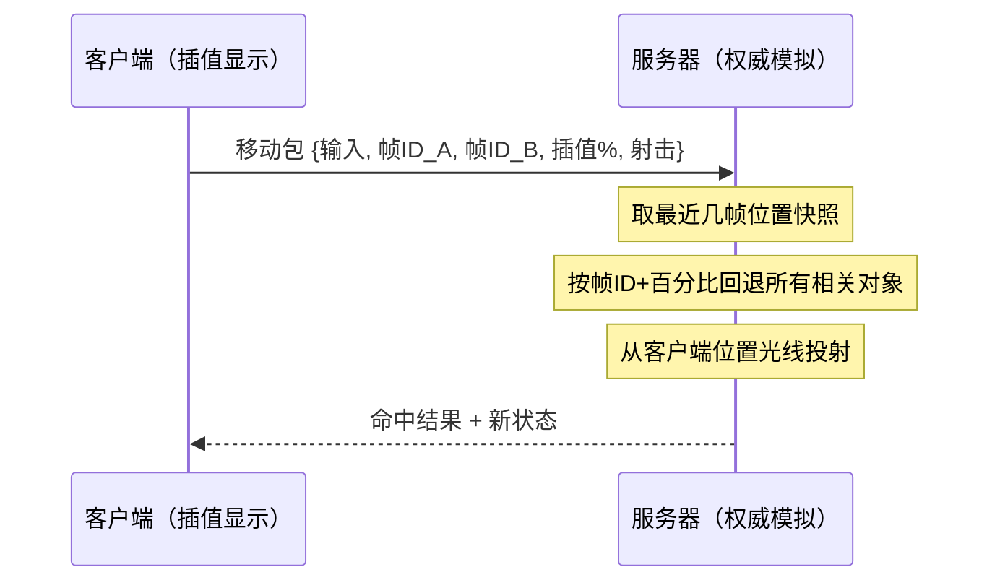

# 第8章 改进的延迟处理

> **小节地图**：§8.1 沉默的终端 / §8.2 客户端插值 / §8.3 客户端预测（含三个小节）/ §8.4 服务器端回退——全章精读。
> 网络侧的账单（延迟/抖动/丢包从哪来）见 [[第7章 延迟、抖动和可靠性|第7章]] §7.1–7.3。

## 8.1 沉默的终端：正确性的基线

Tim Sweeney 的「服务器就是那个人」：权威服务器拓扑里，真实状态只在服务器上，任何客户端看到的都是**过去的状态**。这个延迟由物理定律决定，任何算法都消除不了——后续技术做的全是把它藏进玩家感知不到的地方。

沉默终端（客户端只发输入、收状态、显示）被原文定性为**保守算法**：显示的一切都在「那个时间点附近绝对正确」，代价是延迟全部由玩家承担。三个具体痛点：

1. **动作延迟**：跳跃从按下到看见 = 一个完整 RTT（原文例子 100ms）；
2. **更新率卡顿**：渲染 60fps 但服务器只以 15Hz 发状态 → 同一画面被渲染 4 帧，**花在 GPU 上的钱被带宽抵消**；
3. **瞄准失真**：敌人位置是 100ms 前的，FPS 里这是致命的。

沉默终端是所有后续技术的对照基线：它卖掉了全部体验，换来「永不出错」。

## 8.2 客户端插值：IP ≥ PP 不是调优建议，是公式下限

收到新状态后不立即跳过去，而是在 IP 毫秒内平滑插值过去（**本地感知过滤器**）。核心推导三步：

1. **IP < PP 会卡**：插值提前跑完，下一个包还没到，画面停住——卡顿回来了；
2. **IP > PP 白吃延迟**：插值拖得比必要更慢；
3. 所以 **IP = PP（数据包周期）是唯一正确的取值**，不是倾向，是被两侧约束夹死的解。

由此得到全章最重要的公式（§8.2）：

> **玩家感知延迟 ≈ ½RTT + IP**（IP = PP）

两个直接推论：**RTT 只能用自己发的输入时间戳回环测**（§8.3.2——服务器与客户端时钟不同步，服务器打时间戳让客户端算「包的年龄」这条路不通）；**PP 由带宽决定而不是延迟**——服务器按带宽能撑的频率发包，感知延迟就跟着带宽走。

插值仍是保守算法：玩家看到的永远是「服务器真的模拟过的两个状态之间」的位置，只是滞后多了一个 IP。原文给的补偿手段：**摄像机交互本地处理**（不影响模拟的东西不必等往返），配合插值能抹掉大部分不适感。

## 8.3 客户端预测：从「显示过去」到「推测现在」

插值的天花板是 ½RTT——再平滑也追不上服务器。预测的思路：收到的状态滞后 ½RTT，那就**在此基础上再模拟 ½RTT**，把状态推到「现在」。这要求客户端能跑与服务器**相同的模拟代码**，并且知道 RTT 的近似值。

RTT 的测量（图 8.4）：客户端用自己的时钟给输入包打时间戳 → 服务器原样带回 → 客户端用当前时间减去时间戳 = RTT。原文的警告值得原样记住：

> ½RTT 只是数据年龄的**近似值**。两个方向上的传输速度不一定一样……对大部分实时游戏来说，½RTT 已经足够好。

预测分两类对象，机制完全不同：

### 8.3.1 远程玩家：航位推测

远程玩家的输入客户端永远拿不到，只能假设「**实体继续做当前正在做的事**」：按最后的速度方向外推。这是**乐观算法**——玩家 B 一变向（原文的例子：正跑（1,0）突然转成扫射（0,1)），预测立即分歧。分歧后的三种纠正，按错误幅度选用：

| 纠正法 | 做法 | 适用 |
|---|---|---|
| **即时状态更新** | 直接跳到最新状态（之后继续外推 ½RTT） | 大错误；快节奏 FPS |
| **插值** | 在若干帧内平滑过渡（常配三次样条，让位置与速度同时平滑） | 小错误 |
| **二阶状态调整** | 调整加速度等二阶参数，缓坡归位 | 慢节奏（飞机/机甲），对抖动最敏感的场景 |

原文的洞察：航位推测对远程玩家**够用的真正原因**是玩家 A 根本不知道玩家 B 何时变向——分歧发生了，只要纠正平滑，玩家看不出来。

### 8.3.2 本地玩家：移动预测与重放

本地玩家不能用航位推测，也不能用插值掩盖——**他知道自己在哪，任何漂移他都能察觉**。目标原文说得很清楚：本地玩家的移动手感应该「像在玩单机游戏」。

两个错误方案先排除：

- **完全忽略服务器状态**：手感完美，但与服务器分歧无法收敛——服务器上的碰撞（玩家 B 的真实位置）客户端算不出来，出现「服务器上掉坑死了、客户端毫发无伤」；
- **对复制状态做插值**：本地玩家立刻察觉移动被拉扯。

正解是**移动重放（replay）**，机制四件套：

1. **移动 = 输入状态 + 时间戳**，客户端维护移动列表；
2. 列表里的移动**保留到服务器确认为止**（清单 8.2：`SendInputPacket` 不再发出即清空）；
3. 服务器每次回状态时带上「**已处理到的最后一个移动时间戳**」（`WriteLastMoveTimestampIfDirty`，只传增量——脏标记为真才写）；
4. 客户端收到本地玩家复制状态后：先删掉时间戳 ≤ 该标记的移动（`RemoveProcessedMoves`），再**把剩下的移动逐条重放**（清单 8.3 的 `DoClientSidePredictionAfterReplicationForLocalCat`：对未确认移动依次 `ProcessInput + SimulateMovement`）。

效果：复制状态 + 精确输入重放 ≈ 客户端本来的预测，两者一致就无感；不一致（服务器上有客户端不知道的事件，比如被撞）才需要平滑处理——平滑只发生在**真的发生了意外**的时刻，而不是每次都拉。

清单 8.2 还有一个免费的可靠性设计：每次发**最近 3 个移动**而不是只发新的——丢一个包，同一移动还有两次机会到达。「不能保证可靠，但显著增加可能性」，且不需要任何确认记账。

### 8.3.3 立即反馈的非状态手段

移动重放只解决移动。扣扳机想要枪口立刻响、施法想要立刻抬手——这些不必等服务器产生抛射体：**所有动作都有通知（tell）**（枪口闪光、施法吟唱），时长天然 ≥ 一个往返。客户端在本地立即播动画/音效，服务器产生的真实结果顺着这个时间差到达，正好接上。失败模式（本地的允许状态是旧的，施法被服务器拒绝）罕见且可容忍。

## 8.4 服务器端回退：把世界退回到扣扳机的那一刻

客户端预测能藏住移动延迟，但有一类动作它无能为力：**长距离的即时射击（hitscan）**。玩家用狙击枪精确瞄准、扣扳机，期望百发百中——但客户端瞄准所依据的目标位置是航位推测/插值出来的近似值，**客户端上的完美瞄准，到了服务器上就偏了**。

方案由 Valve 的 Source Engine（《反恐精英》）推广流行，核心一句话：**当判定命中时，让服务器的状态退回到玩家扣扳机那一刻所看见的世界**。四个要件，缺一不可：

| # | 要件 | 为什么 |
|---|---|---|
| 1 | **远程玩家用客户端插值，不用航位推测** | 服务器必须能**精确知道**每个客户端「此刻看见了什么」。航位推测基于假设的向前模拟，服务器无法重建那个假设。插值周期（IP=PP）由服务器牢牢控制 |
| 2 | **本地玩家保留预测与重放** | 要件 1 引入的插值延迟（½RTT+IP）对远程玩家无感、对本地玩家敏感——靠移动重放把它藏掉 |
| 3 | **每个移动包携带客户端视角**：当前插值的**两帧 ID + 插值进度百分比** | 「客户端看见了什么」的精确描述——不是时间戳（时钟不可靠），是「在这两帧状态之间、偏移多少」 |
| 4 | **服务器存储每个相关对象最近几帧的位置** | 回退的数据来源。收到带射击的输入包 → 取出两帧 ID 与百分比 → 把所有相关对象回退到那个插值位置 → 从客户端位置**光线投射**判定命中 |

**存储量极小**：只需「最近几帧」——覆盖 `½RTT + IP` 的回退窗口即可（RTT 100ms、IP 67ms 的典型值，200ms 的位置历史绰绰有余）。服务器不需要做完整的时间回滚/重模拟，只需要**位置历史查询**——这是该方案工程上便宜的原因。

**代价：被击中者的世界**。玩家 B 延迟 300ms，他屏幕上的玩家 A 还没躲进角落——他瞄的是旧世界，服务器回退到旧世界判定命中，**玩家 A 在自己屏幕上明明已经躲好了，却被击中**。原文的结论是权衡不是对错；且**延迟越高的人越占便宜**（他的世界越旧，回退窗口越大）是内生属性。

**最小实现判据**：①客户端每帧记录 `snapshot_tick_A + snapshot_tick_B + interp_t`；②服务器环形缓冲存最近 N 帧相关对象位姿；③射击输入包附三元组，命中判定在缓冲中重建那帧位置后做光线投射；④远程玩家显示走插值、本地玩家走预测+重放——两条线别混。

## 章末选型判据

| 对象/动作 | 该用什么 | 为什么 |
|---|---|---|
| 远程玩家的位姿 | 客户端插值（IP=PP） | 输入未知，预测必然猜错；插值保守且平滑 |
| 远程玩家的远期外推 | 航位推测 + 分级纠正 | 需要「现在」的近似；错误对旁观者不敏感 |
| 本地玩家的移动 | 移动预测 + 重放 | 对漂移零容忍；输入在手，重放可精确收敛 |
| 摄像机 | 本地立即处理 | 不影响模拟，无往返必要 |
| 动作反馈（音效/动画） | 本地先行（tell 技巧） | 通知时长天然覆盖往返 |
| 即时长距离射击 | 服务器端回退 | 预测解决不了这个 |

一句话结论：**插值卖掉 IP 毫秒换平滑（保守），预测卖掉纠错复杂度换零滞后（乐观），移动重放用「重放未确认输入」让本地玩家既零滞后又不失控，服务器回退把判定退回玩家看见的那一刻——四者不是替代关系，是按对象分工的叠层。**
