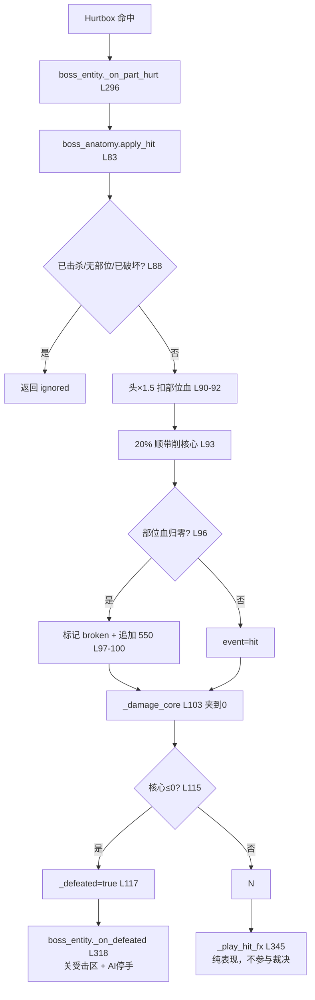

> [!info] 核心概念
> Boss 的伤害裁决被切成**两个互不依赖的对象**：`sim/boss_anatomy.gd` 是纯逻辑
> （部位血量 / 倍率 / 核心连锁 / 胜负），`view/boss_entity.gd` 是表现与转发
> （受击区几何 / 转向 / 受击反馈）。view **不算任何数值**，只消费 anatomy 返回的事件字典。
> 这条分层不是洁癖——`sim/` 三个文件将来整体搬到 C++ 服务器，混进渲染依赖就要重写整个战斗层。
> 部位是**五部位**（Head / WingL / WingR / Tail / Leg），且**打不打得到由朝向决定**：
> 受击区是逐朝向一张生成表，不是"一组固定形状整体旋转"。

> [!warning] 本文取代旧笔记
> `Boss部位节点系统-boss.gd` 描述的是 2026-08 的原型（单文件 `scripts/boss.gd`，
> 部位为「左前爪/右前爪/背部」，头部是眩晕条而非破坏）。**那个文件已不存在**，
> 架构已重构为 sim/view 分离 + B1 五部位。旧笔记已改为跳转说明。

## 文件概览

| 项目 | 内容 |
|---|---|
| 涉及文件 | `sim/boss_anatomy.gd`（111 行，裁决层）、`sim/boss_aggro.gd`（89 行，仇恨）、`view/boss_entity.gd`（298 行，表现层）、`config/boss_zone_metrics.gd`（**生成物**，勿手改） |
| 依赖 | 无。`sim/` 不 import 任何渲染、不碰 `get_tree()`、不用全局随机 |
| 审计 | `bash test/check_sim_purity.sh` 守住这条约束 |
| 实现状态 | 已验证；`test_boss_anatomy.gd` 逐条断言配平口径与 ignore 分支 |

## 源码领读：一次命中从头走到尾

### 起点：受击区命中 → Hurtbox → entity 转交

受击判定在物理层完成，命中后由 `boss_entity._on_part_hurt()`（L296）转交 sim：

```gdscript
# L296  受击 → 唯一的裁决入口
func _on_part_hurt(part: String, data: DamageData) -> void:
	var ev := _sim.apply_hit(part, data.amount, data.timestamp)
	_play_hit_fx(ev)      # L345 表现只消费 ev，不参与裁决
	if ev["defeated"]:
		_on_defeated()    # L318
```

**参数注入而非引用 autoload**：`setup(config)` 收一个 Dictionary，
所有数值来自 `GameConfig` 在装配期传入。sim 因此可以被单测直接 new 出来跑。

### 核心：结算 `boss_anatomy.apply_hit()` L83~L106

```gdscript
# L83  唯一的状态变更入口
func apply_hit(part: String, damage: int, timestamp: int = 0) -> Dictionary:
	var ev := {"event": "ignored", "part": part, "hp": part_hp(part), ...}
	# L88  第二道闸：已击杀 / 部位不存在 / 部位已破坏
	if _defeated or not _part_hp.has(part) or _broken[part]:
		return ev
	var mult: float = _config["head_mult"] if part == "head" else 1.0   # L90
	var dmg := int(round(damage * mult))
	_part_hp[part] = maxi(0, _part_hp[part] - dmg)                        # L92
	var core_dmg := int(round(float(dmg) * float(_config["core_chip_ratio"])))  # L93
	if _part_hp[part] == 0:                                               # L96
		_broken[part] = true
		ev["event"] = "broken"
		core_dmg += int(_config["break_core_damage"])                     # L100
	else:
		ev["event"] = "hit"
	ev["core_damage"] = _damage_core(core_dmg)                           # L103
	return ev
```

**结算顺序是有意义的，顺序错了配平就崩**：

1. **L88 三合一闸**：已击杀 / 部位不存在 / 部位已破坏 → `ignored`。
   这是**第二道**闸——第一道在物理层（已破坏部位的 hurtbox 已被置为
   `monitorable=false` + `shape=null`）。两道闸的分工：**物理层挡"打不到"，
   逻辑层挡"打到了也不算"**。
2. **L90 倍率**：只有头有倍率（`head_mult=1.5`），其余部位 1.0。
   头**始终暴露**是暴露表（`exposed`）的事，不是倍率的事，两者独立。
3. **L92~93 核心连锁**：任何命中都按 `core_chip_ratio`(0.20) 顺带削核心。
   **核心血不是第六个部位，也没有独立受击区**——整条龙 100% 被 5 个部位盖满。
4. **L96~100 破坏追加**：部位血归零时，**额外**扣 `break_core_damage`(550)。
5. **L103 实际扣血**：见下。

### `_damage_core()` L110~L118 —— 夹到 0 而不是扣成负数

```gdscript
func _damage_core(amount: int) -> int:
	var applied := mini(amount, _core_hp)     # L113  扣不到负数
	_core_hp -= applied
	if _core_hp <= 0:
		_defeated = true                       # L117
	return applied
```

返回**实际**扣掉的量而不是 `amount`。这一点在阶段二很关键：服务器广播的
`core_hp` 必须能被客户端反归一化成与本地一致的进度条。

**配平口径**（写进代码注释，HUD 进度条的含义）：
`5 破 ×550 + 沿途芯片 ≈ 3000 = 核心血` → **破完全部部位正好击杀**。
这条等式是 `test_boss_anatomy.gd` 的核心断言，改任一参数必须同步。

### `setup()` L37~L50 —— 那个"先铺默认值"不是冗余

```gdscript
# L41  先铺默认值再 merge
_config = {"head_mult": 1.0, "core_chip_ratio": 0.0, "break_core_damage": 0}
_config.merge(config, true)
```

核心血那一组参数是**后加的**。老调用方（单测、早期场景）只传部位那一组，
缺键直接 `_config["core_chip_ratio"]` 会在 `apply_hit` 里抛
`Invalid access to property or key`——**而且抛在 sim 内部最难查**（没有节点树、没有场景可看）。

> 这是"纯逻辑层"的一个非直觉收益：**它没有调用栈现场可看**，
> 所以所有参数访问都必须是防御性的。

## 关键数据结构

### `boss_anatomy.gd` 内部状态

| 成员 | 行 | 类型 | 说明 |
|---|---|---|---|
| `_part_hp` | L15 | `Dictionary` | part → 当前血量 |
| `_broken` | L16 | `Dictionary` | part → bool，**永久**破坏（不是时限） |
| `_config` | L17 | `Dictionary` | 注入参数，含 `exposed` 暴露表 |
| `_core_hp` / `_core_max` | L25-26 | `int` | 核心血 / 上限（3000） |
| `_defeated` | L27 | `bool` | 终局标志，一旦 true 一切命中 ignored |

### `exposed` 暴露表（`config["exposed"]`）L65~L67

```gdscript
func exposed_parts(facing: String) -> Array:
	return _config["exposed"].get(facing, ["head"])
```

`facing` → 该朝向可命中部位集合。**内容来自 GameConfig，不是规则表**——
四个朝向的碰撞体积本来就不同（侧视图只画得出一只翅膀），"固定形状转 90°"
是已踩过的错。

⚠️ 默认值是 `["head"]`：**查不到朝向时宁窄勿宽**。暴露错了会漏判伤害，
暴露宽了会让玩家打到自己看不见的地方。

### `boss_entity.gd` 表现层状态

| 成员 | 行 | 说明 |
|---|---|---|
| `_hurtboxes` | L32 | part → Hurtbox，规则**物理化**：破坏即 `monitorable=false` + `shape=null` |
| `_zone_pending` / `_zone_wait` | L33-34 | 转向动画未播完，受击区**不换挡**（几何只准滞后） |
| `_zone_settle_frames` | L35 | 布局已下发后多压的帧数（`set_deferred` 到帧末才落地） |
| `_stagger_left` | L37 | 部位破坏的**时限**硬直余额（头破 2.0s） |
| `_speed_mult` | L38 | 腿破 → **永久**减速 ×0.6 |

## 核心流程



**破坏是永久的，即时效果是时限的**——这是 2026-10-06 拍板的口径：
头破 → 2.0s 硬直（时限），腿破 → 永久减速 ×0.6（永久）。
两种"效果"分开存（`_stagger_left` / `_speed_mult`），不要合成一个计时器。

## API 接口说明

| 文件 | 接口 | 签名 | 说明 |
|---|---|---|---|
| boss_anatomy | `setup` | `(config: Dictionary)` | 参数注入，唯一有外部依赖的入口 |
| boss_anatomy | `apply_hit` | `(part, damage, timestamp=0) -> Dictionary` | **唯一状态变更入口**。返回事件字典 |
| boss_anatomy | `exposed_parts` | `(facing: String) -> Array` | 该朝向可命中部位 |
| boss_anatomy | `is_broken` / `part_hp` / `core_hp` / `is_defeated` | `() -> …` | 只读查询 |
| boss_anatomy | `snapshot` / `restore` | `() -> Dictionary` / `(snap)` | 广播体 + 回滚校正。**阶段二服务器口子的预留** |
| boss_aggro | `add_threat` | `(player_id: int, damage: int)` | 命中累积威胁 |
| boss_aggro | `update` | `(players, boss_pos, dt) -> Dictionary` | 输出 `{state: idle/chase/attack, target_id}` |
| boss_entity | `part_event` | `signal(ev: Dictionary)` | 阶段二广播事件与本地事件**同形**，表现层零改动 |
| boss_entity | `zones_settled` | `() -> bool` | 受击区几何是否已落定（见踩坑区） |
| boss_entity | `set_facing` | `(dir: String, moving := false)` | **一次发完朝向与移动两个意图位** |

## 设计要点

1. **sim/view 分离不是分层洁癖，是"这段代码要搬到服务器"**。
   `sim/` 的三个文件按服务器口子设计：参数注入、无随机、无时钟、无场景树。
   混进渲染依赖，第 5 层就要重写整个战斗层。审计脚本
   `check_sim_purity.sh` 把它变成**当场暴露**而不是"第 5 层才炸"。

2. **view 不算数值，只消费事件**。哪里发现 view 在算血，就是越界。
   事件字典是**唯一输出通道**，这让"阶段二把本地结算换成发服务器消息"
   变成改一处调用，不是改整个表现层。

3. **受击区是生成物**：`config/boss_zone_metrics.gd` 由 `zones_from_refs.py` 生成。
   **换素材必须重跑**，且这条**没有任何自动提示**——素材一换不重跑，
   受击区会整体压在别的地方（实测压到过脖子），表现层的命中反馈跟着一起错。

4. **本体碰撞体也必须实测**：`GameConfig.boss_body_poly` 是四朝向
   **轮廓掩膜的交集**。用矩形会有两个后果：玩家被挡在怪物图形**外面**够不到受击区；
   更隐蔽的是 `boss_ai` 的停步距离小于该距离 → 玩家永远进不了攻击范围 →
   **Boss 永远在走，行走动画无限循环**，看着像"AI 卡了"。

5. **"几何只准滞后"是对的方向**：转向动画播完才换受击区，
   否则判定与画面差半拍。但**判定要滞后、表现不能撒谎**——
   常驻的破坏标记每帧按滞后几何重画，就会读成"残影"。

6. **`set_facing` 一次发完两个意图位**。改前 `boss_ai._face_towards()` 先调
   `set_facing(dir)`（内部已发方向意图），紧跟着又发一次带 moving 的 ——
   动画树的 `_set_rig_moving()` 带记账，值没变就早退，记账与实际意图失同步后
   **站定中转完身会原地无限走**。也不能改走 `_set_rig_moving()`（同样会被早退挡掉），
   也不能简单删掉第二发（会引入"转弯后站住不走"）。**加参数是唯一干净的解。**

7. **快照/restore 现在不用但必须留着**：它们是阶段二"服务器广播"与
   "客户端回滚校正"的接口。删掉省 10 行，但接服务器时得重写一遍。

## 关联笔记

- [[游戏开发-MOC|游戏开发 领域MOC]]
- [[多人网络-MOC|多人网络 领域MOC]]（这些 `snapshot`/`restore` 将来接的是服务器广播）
- [[第5章 对象复制|全量快照与增量]]（`snapshot()` 的线格式与幂等性论证）

## ⚠️ 踩坑/待办

### 已确认的坑

- **`intersect_shape` 默认不查 Area2D**：必须显式开 `collide_with_areas`，
  否则部位（Area2D）永远打不到。
- **`intersect_shape` 结果没有 `position` 键**：那是 `intersect_ray` 的字段。
  取它会运行时报错、攻击函数中断——**旧版 Demo 的普攻实际从未真正结算过伤害**。
- **`CollisionShape2D` 必须是 CollisionObject2D 的直接子节点**。套一层 `Node2D`
  容器会**静默失效**：形状对象还在、读得到、画得出来，**但物理上不存在**
  （玩家直接穿过 Boss）。读形状抓不到这个 bug，要问物理服务器
  `PhysicsServer2D.body_get_shape_count(boss.get_rid())`。
- **Hitbox 激活后要等两个物理帧再补扫 overlap**。`area_entered` 只在"开始重叠"
  时触发，贴脸挥刀会静默丢伤害；但只等**一个**帧时 Area 刚进 broadphase、
  overlap 列表还是空的，补扫扫到空会让命中退化成"谁先到谁算"——**顺序是随机的**。
- **常驻破坏标记不能跟着滞后的几何画**（G1 缺陷）。解法是几何未落定时整层不画，
  落定后按新朝向重画。**判定侧一点没动**。
- **残影窗口按出货配置算**：`skip_turn=true`（硬切朝向，Boss 不起转身动画），
  窗口 = `boss_zone_settle_delay` = 0.15s（约 9 帧），不是"转身链 5.4s"
  （那是只在测试里开的链式模式）。
- **GDScript 缩进全文件必须一致**（本项目统一 tab）。混用会解析失败、整个脚本不编译。

### 【待确认】的问题

> [!question] 【待确认】受击区精细化（对应项目侧缺口 G2）
> down 视图腿区过小 / 侧视 head 吞前胸 / 多边形块状。手勾框 + 最近邻填充的固有粗糙度，
> 改手勾参考场景后重跑生成器即可。**判"判定坏了"时先量覆盖率，别猜锚定**——
> 读取器每次跑都打印覆盖率，掉了就是有框没勾对。
