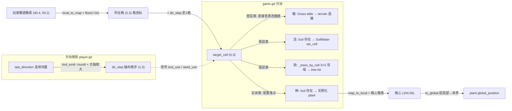

> [!info] 核心概念
> 这是 Godot 4 农耕 Demo（rapidvectors 教程，仿 Croptails）场景层 `game.gd` 里的**统一目标格模型**：玩家所有交互（锄地 / 浇水 / 砍树 / 播种）共用一条 `_get_target_cell()` 换算管线——**玩家脚底像素 → `local_to_map` 归整为"所在格" → 沿面朝方向走 1 格 → 目标格**。图层类操作（锄、浇）拿到格坐标后直接 `set_cell`/改地形，不改像素；而**实体类落点**（plant）还要再走一次反向换算 `map_to_local`（格→格心像素）+ `to_global`（层局部→世界）。
>
> 全篇的钥匙是一句话：**一个格子是"区域"不是"点"，而游戏对象要落在"点"上**——所以必须在 格坐标(Vector2i，离散) 与 像素坐标(Vector2，连续) 之间来回换算。`16px` 只是换算系数（tile_size），不是"需要换算"的原因。

## 文件概览

| 项目 | 内容 |
| --- | --- |
| 文件 | `scenes/level/game.gd`（91 行，主锚点） |
| 核心类/结构 | `Game`(Node2D)、`soil`(TileMapLayer)、`_trees_by_cell`(Dictionary: 格坐标→树) |
| 涉及文件 | `scenes/player/player.gd`（`tool_emit()` L121 方向→格步收敛）、`scenes/level/plant.tscn`（落点实体）、`scenes/tree.tscn`+`tree.gd`（被索引对象）、`scenes/level/game.tscn`（图层树） |
| 依赖 | Godot 4.x TileMapLayer；地形组 0 `set_cells_terrain_connect`；图层名约定 `GrassMapLayer/SoilMapLayer/SoilWaterMapLayer` |
| 数据流关键 | `tool_use` / `seed_use` 信号（player.gd 发射）→ `game.gd` 接收 → 统一算 `target_cell` → 分派 |
| 实现状态 | 已实现；plant 播种流程刚跑通（含 map_to_local 语义纠偏），生长与占用判定待补 |

## 源码领读：跟着一条"目标格"走完整条管线

整条链路横跨 `player.gd`（玩家侧信号）与 `game.gd`（场景侧处理），核心是 **"决策用格、落点用像素"的双程换算**。

### 前置：方向收敛成"轴向格步" — `player.gd` `tool_emit()` L121~L130

```gdscript
func tool_emit(kind: EmitKind):
    var step := Vector2i(roundi(last_direction.x), roundi(last_direction.y))  # L124
    if step.x != 0 and step.y != 0:                                          # L125 斜向收敛
        step = step if absi(step.x) >= absi(step.y) else Vector2i(0, step.y) # L126 主轴判定
    if kind == EmitKind.TOOL:
        tool_use.emit(current_tool, Vector2(step))      # L128
    elif kind == EmitKind.SEED:
        seed_use.emit(current_seed, Vector2(step))      # L130
```

- 玩家方向是**连续 8 方向**（摇杆/斜键），而格是 4 邻域。这里在**玩家侧**就收敛成"只沿一条主轴走一格"，避免把斜对角格当目标。
- 斜向时比较 `abs(step.x)` 与 `abs(step.y)`，取绝对值更大的轴——"面朝右下的更右"就对右边的格动手。
- **为什么在玩家侧收敛而不是场景侧**：目标格的"哪一格"语义应由玩家负责表达，场景只按格干活，两边职责干净。

### 入口：树索引建一次 — `game.gd` `_ready()` L14~L19

```gdscript
soil = $Layers/SoilMapLayer                                          # L16
for tree in get_tree().get_nodes_in_group("Trees"):                  # L17 仅此一次全遍历
    var cell: Vector2i = soil.local_to_map(tree.global_position + Vector2(0, BASE_OFFSET))  # L18
    _trees_by_cell[cell] = tree                                      # L19
```

- 场景加载时把每棵树登记到它**脚底所在格**。之后砍树查 `_trees_by_cell` 是 O(1)，不再全图遍历 Trees 组。
- `local_to_map` 首次出现：树的 `global_position` 是**原点（帧中心）**，加 `BASE_OFFSET`(12) 落到"脚底"，再问"这脚站在哪格"。

### 核心：`_get_target_cell()` — 像素 → 格 + 步进 — L80~L91

```gdscript
func _get_target_cell(dir_step: Vector2) -> Vector2i:
    var feet = player.global_position                                   # L83 连续像素
    if dir_step != Vector2.DOWN:                                        # L86 朝下特判
        feet = feet + Vector2(0, BASE_OFFSET) as Vector2               # L87 帧中心→脚底
    var from_cell := soil.local_to_map(feet)                            # L89 像素 → 所在格
    return from_cell + Vector2i(dir_step) as Vector2i                   # L91 格尺子上走 1 格
```

- **L83**：`player.global_position` 是帧中心，不是脚底。玩家帧 48×48，原点居中，脚底得往下估一段（`BASE_OFFSET=12`）。
- **L86~87 朝下特判**：朝下时，目标本就是"脚底正下方那一格"。此时若仍把基准点下移 12px，`local_to_map` 会把基准点推进到**再下面一行**，多锄一格。这是全文件最容易漏的边界。
- **L89**：`local_to_map` 是换算主力——`floor(像素 ÷ tile_size)`，把玩家在格内的**任意亚像素位置吸收成同一个整数格**。这就是"归整"：站在格内 `x=2.7` 还是 `x=14.1`，算出的都是同一格，锄地不再随站姿漂移。
- **L91**：目标格 = 所在格 + 一步。步进必须发生在**格尺子**上，才能表达"精确往前一块地"——像素尺子上"往前 16px"取决于你此刻站在格内哪，语义是糊的。

### 分发 A：图层类工具（锄 / 浇）— `_on_player_tool_use()` L23~L50

```gdscript
var target_cell = _get_target_cell(dir_step)                            # L25 四工具共用

if tool == player.Tools.HOE:                                            # L28 锄
    var cell = $Layers/GrassMapLayer.get_cell_tile_data(target_cell) as TileData
    if cell and cell.get_custom_data('able'):                           # L32 可耕地标记
        soil.set_cells_terrain_connect([target_cell], 0, 0)            # L34 单格地形连接

if tool == player.Tools.WATER:                                          # L37 浇
    if $Layers/SoilMapLayer.get_cell_tile_data(target_cell):           # L39 已有土才算锄过
        $Layers/SoilWaterMapLayer.set_cell(target_cell, 0, Vector2i(randi_range(0, 2), 0))  # L42

if tool == player.Tools.AXE:                                            # L45 砍
    var tree = _find_tree_near(target_cell)                            # L47
    if tree:
        tree.hit()                                                      # L49
```

- 锄 / 浇/砍 **全程只用格坐标**，改的是 TileMapLayer 的**图层数据**（`set_cell` / 地形连接），不需要任何像素位置。
- 三个分支读三种图层做校验，职责分明：锄读 Grass（找草地+`able` 标记）、浇读 Soil（确认锄过）、砍查 `_trees_by_cell`。
- `set_cells_terrain_connect([target_cell], 0, 0)`：地形连接函数收**数组**；`set_cell` 收**单个 Vector2i**。两者参数形制不同，混传会报错。

### 分发 B：实体类工具（种 plant）— `_on_player_seed_use()` L69~L77

```gdscript
func _on_player_seed_use(_seed: int, dir_step: Vector2) -> void:
    var target_cell = _get_target_cell(dir_step)                        # L71 同一条管线
    if $Layers/SoilMapLayer.get_cell_tile_data(target_cell):            # L73 必须是锄过的土
        var plant = plant_scene.instantiate()                           # L74
        $Objects.add_child(plant)                                       # L75 挂 Objects（开 y-sort）
        plant.global_position = soil.to_global(soil.map_to_local(target_cell))  # L77 ⭐反向换算
```

- 判定播种资格时用**格坐标**（L73 查 Soil 层有没有这块土）；真正安放 plant 时却要**像素坐标**——plant 是实体节点，必须落在具体点。
- **L77 是本篇的钥匙行**，三个换算一次看清：
  - `map_to_local(target_cell)`：格 → **该格中心**的**层局部**像素坐标（官方语义，不是左上角）。
  - `to_global(...)`：把层的局部坐标桥接成**世界坐标**（层若被挪过/缩放过，数值才不变错）。
  - 赋给 `global_position`：plant 挂在 `$Objects` 下，用世界坐标最稳，跨层级不错位。
- plant 挂在 `$Objects`（已 `top_level=true` + `y_sort_enabled`），会与玩家、树正确按 Y 遮挡。

### 核心流程图



## 关键数据结构

### `game.gd`

| 成员 | 类型 | 说明 |
| --- | --- | --- |
| `player` | Node2D | `@onready` 引用 `$Objects/Player`（L3） |
| `plant_scene` | PackedScene | 预载 `plant.tscn`（L5） |
| `_trees_by_cell` | Dictionary | 键 `Vector2i` 格坐标 → 值 树 StaticBody2D（L8）；`_ready` 建一次，砍树 O(1) |
| `BASE_OFFSET` | const int = 12 | 实体"帧中心→脚底"像素偏移（L10）；只服务"判定站在哪格"，**与 plant 对齐无关** |
| `soil` | TileMapLayer | `_ready` 里绑定 `$Layers/SoilMapLayer`（L11/L16） |

### 图层命名约定（`game.tscn`）

| 图层节点 | 存什么 | 谁读写 |
| --- | --- | --- |
| `GrassMapLayer` | 原始草地 | 锄头读（查 `able`） |
| `SoilMapLayer` | 锄过的土壤 | 锄头写（terrain 连接）；水壶/种子读（判定"锄过"） |
| `SoilWaterMapLayer` | 湿润水渍 | 水壶写 |
| `Objects` | Player / Tree / Plant | 实体层，`top_level`+`y_sort_enabled`，plant 挂这继承 Y-sort |

## 核心流程：换算矩阵

| 阶段 | 尺子 | 对象 | 代表语句 |
| --- | --- | --- | --- |
| 玩家移动 | 像素(连续) | player | `move_and_slide()` |
| 方向→格步 | 格(离散) | player | `tool_emit()` roundi+主轴 |
| 脚底→所在格 | 像素→格 | game | `local_to_map(player.global_position + (0, BASE_OFFSET))` |
| 所在格→目标格 | 格 | game | `from_cell + Vector2i(dir_step)` |
| 图层操作(锄/浇) | 格 | game | `set_cell` / `set_cells_terrain_connect` / 字典查树 |
| 实体落点(种) | 格→像素→世界 | game | `to_global(map_to_local(cell))` |

> [!tip] 为什么要换两次（像素→格→像素）
> 决策必须发生在**格尺子**上才能消除玩家站姿的亚像素抖动；但实体必须落在**点**上，所以种 plant 要先转成格做资格判定、再转回格心安放。**"决策用格、落点用像素"，一趟处理里两个方向各用一次。**

## API 接口说明

| 文件 | 接口 | 签名 | 说明 |
| --- | --- | --- | --- |
| player.gd | signal `tool_use` | `(tool: Tools, dir_step: Vector2)` | 图层类工具事件，方向已收敛为轴向格步 |
| player.gd | signal `seed_use` | `(seed: Seeds, dir_step: Vector2)` | 播种事件 |
| player.gd | `tool_emit` | `(kind: EmitKind)` | 统一出口：方向收敛后按 kind 发 `tool_use`/`seed_use` |
| player.gd | `axe_use` | `()` | 挥砍动画 method track 在落刀帧调用（命中时机贴合动作） |
| game.gd | `_get_target_cell` | `(dir_step: Vector2) -> Vector2i` | 全篇核心：像素脚底 → 目标格（四工具共用） |
| game.gd | `_on_player_tool_use` | `(tool: int, dir_step: Vector2)` | 锄/浇/砍三分支分发 |
| game.gd | `_on_player_seed_use` | `(_seed: int, dir_step: Vector2)` | 播种：判土→实例化→格心安放 |
| game.gd | `_find_tree_near` | `(cell: Vector2i) -> Node` | 3×3 邻域最近树（O(1) 查表，非全遍历） |
| tree.gd | `hit` | `()` | 受击闪白 shader 动画 |

## 设计要点

1. **统一目标格 `_get_target_cell()`，一处修改全局生效**（用户明确诉求之一）。锄/浇/砍/种四种交互此前各自推算目标位置、各有一套半格偏移经验值，必然在部分站位漂移。收敛成一条管线后，方向一步在格尺子上走，边界天然对齐。

2. **"决策用格、落点用像素"**——这是读懂的钥匙。图层类操作（锄/浇/砍）改的是 TileMap 数据，给格坐标就够；只有生成实体的播种才需要像素落点。所以四种工具不是"要不要坐标换算"的区别，而是"算到格就停，还是要再换回像素"。

3. **先归整成格再步进，消灭亚像素抖动**。玩家连续站立位置可能落在格内任意点；直接 `像素 + dir×16` 会把目标定在"格内随机点"而非整格——这是最初锄地"地块偏移" bug 的根因。`local_to_map` 的归整把站姿不确定性吸收掉了。

4. **`map_to_local` 返回"格中心"，不是左上角**（官方语义）。曾经误以为返回左上角而自作主张 `+ tile_size/2`，结果 plant 整体偏右下 8px——正是用户报"草在土块右下方"的根因。**官方已有格心锚点函数，不要再自补半格。**

5. **`BASE_OFFSET`(12) 与 plant 对齐是两回事，别串**。BASE_OFFSET 是"帧中心→脚底"的像素经验值，只服务于**判定玩家/树站在哪格**（树、玩家原点在 48px 帧中心）。plant 原点就是要坐在格心、根部自然扎格下半部，套 BASE_OFFSET 反而错位。

6. **用 TileMapLayer 内建换算，不自造 `格×16+8`**。内建方法自动吸收 tile_size、图层 offset、父级缩放；`16px` 只是系数，手写公式在图层被整体移动/缩放时会错。

7. **`to_global` 桥接场景层级**。`map_to_local` 返回的是 **TileMapLayer 局部坐标系**；plant 挂到 `$Objects`（场景另一处），要的是世界坐标。`layer.to_global(layer.map_to_local(cell))` 是社区处理该问题的标准句式。

8. **`_trees_by_cell` 格索引取代全图 Trees 遍历**（用户明确诉求之二）。`_ready` 建一次 O(n)，之后砍树 O(1)；判定放宽到 3×3 邻域（树占位大、玩家可能被碰撞挡着贴不到目标格），多棵候选取离格心最近者。

## 关联笔记

> 编写时查阅 [[游戏开发-MOC]]（游戏开发领域地图）。本分区以 Godot/GDScript 为域，网络/C++ 域 MOC 不适用。

- [[游戏开发-MOC|游戏开发 领域MOC]]
- [[Godot场景与节点入门|Godot 场景与节点入门]]（场景/节点/物理体三兄弟等前置概念）
- [[Boss部位节点系统-boss.gd|Boss部位节点系统]]（同分区另一篇 GDScript 源码分析，注意其脚本缩进为 **tab**、本文项目为 **空格**）
- [[Godot坐标体系与TileMap|Godot 坐标体系与 TileMap]]（格坐标/局部/世界/屏幕四坐标 + 双程换算原理，本文是其源码落地实例）

## ⚠️ 踩坑/待办

### 已确认的坑

- **`map_to_local` 返回格中心而非左上角**。曾误加 `tile_size/2`，plant 整体偏右下 8px（"草在土块右下方"）。官方语义见 TileMapLayer 文档；格心定位直接 `to_global(map_to_local(cell))` 即可。
- **GDScript 缩进字符全文件必须一致**：`_on_player_seed_use` 曾被写成 tab，而文件其余部分是 4 空格 → Godot 解析失败、整个脚本不编译，播种逻辑从未真正执行。Godot 4 允许空格也允许 tab，**但不允许混用**。另注意：本文项目统一 **4 空格**；同库 `Boss部位节点系统-boss.gd` 所在项目（otf-game）统一 **tab**——跨项目别照搬缩进风格。
- **`set_cell` 收单个 `Vector2i`，`set_cells_terrain_connect` 收数组**。把 `[target_cell]` 传给 `set_cell`（或把单格传给 connect）都会报错，参数形制完全不同。
- **朝下方向的特判**（L86~87）：面朝下时若仍给基准点加 `BASE_OFFSET`，会把基准点推到再下一行、多锄一格。这是统一管线里最隐蔽的边界，改 `BASE_OFFSET` 或帧高时务必回归测朝下四种工具。
- **Dictionary.get 返回 Variant**：`_trees_by_cell.get(cell)` 后要 `as StaticBody2D` 才能让后续属性/方法链通过静态类型推断，否则报"类型无法推断"。

### 【待确认】的问题

> [!question] 【待确认】plant 视觉是否真正居中？
> 若把 L77 改成官方格心写法后仍有轻微偏移（且不是 8px 整），则问题不在坐标算法，而在 `corn.png` 素材**帧内图像未占满/不对称**（素材锚问题），需给 Sprite 加 `offset` 微调，而非改坐标换算。当前素材图未能直接预览，待目测确认。

> [!todo] 【待补充】同一格重复播种无占用判定
> 目前无 `_plants_by_cell` 占用检查，对同一格连续播种会叠苗；后续加生长脚本时可仿 `_trees_by_cell` 做"此格已有作物则拒绝"。

> [!todo] 【待补充】plant 无生长脚本
> `plant.tscn` 是静态 StaticBody2D，`hframes=4` 已留好生长帧位，切帧/成熟/收获逻辑尚未实现。

> [!question] 【待确认】`BASE_OFFSET = 12` 的经验来源
> 玩家帧 48×48、原点在帧中心，理论上脚底偏移应为 ~24；当前用 12 说明教程素材的帧内角色画面未占满整帧（留白使视觉脚底比帧底高）。数值依赖具体素材，换素材/帧尺寸需重调。

> [!question] 【待确认】`_seed` 参数暂未使用
> `_on_player_seed_use(_seed: ...)` 预留了种子类型，但目前三种种子表现相同；后续做"不同种子不同作物"时按 `_seed` 分支即可。
