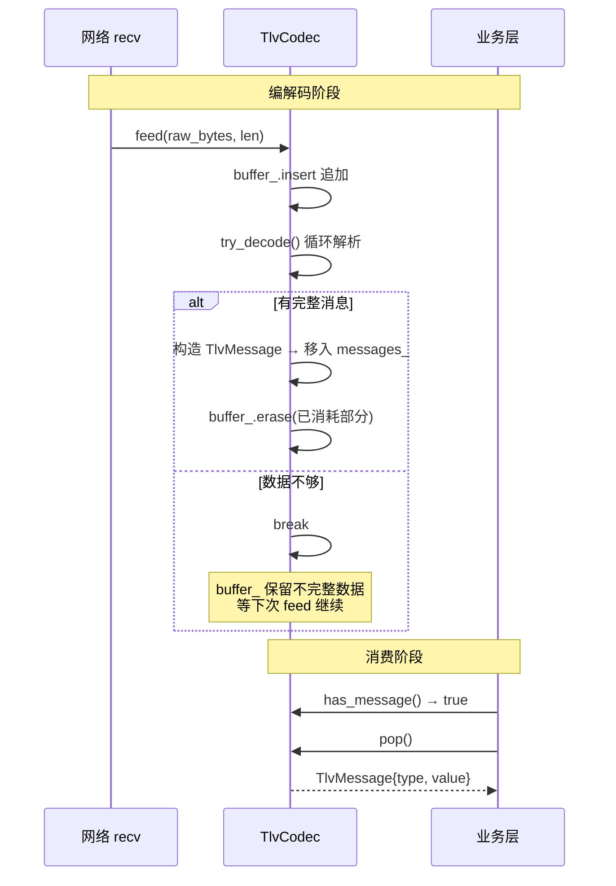
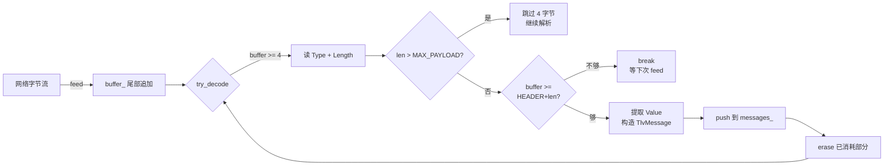

> [!info] 核心概念
> **TlvCodec** 是一个极简的 TLV（Type-Length-Value）协议编解码器，用 **增量解析** 方式处理 TCP 粘包和拆包。核心设计是：`feed()` 追加原始字节流 → 内部 `try_decode()` 边解析边消费 → 完整消息移入已解析队列 → `has_message()`/`pop()` 取出。剩余不完整数据留在缓冲区等待下次 feed。

## 文件概览

| 项目 | 内容 |
| --- | --- |
| 文件路径 | `src/base/tlv_codec.hpp` |
| 核心类 | `TlvCodec`（编解码器）、`TlvMessage`（消息结构） |
| 命名空间 | `TlvType`（协议常量定义） |
| 依赖 | 无（纯标准库：`<cstdint>`、`<cstring>`、`<vector>`、`<stdexcept>`） |
| 行数 | 174 行 |
| 构建目标 | header-only，被 `game_gateway_v1.cpp` 等源文件包含 |

## 关联文档

- [[6-游戏网关V1-game_gateway_v1.cpp]] — 本编解码器的使用者，在 `handle_read` 中调用 `codec.feed()` → `codec.pop()`
- B 游戏服务器应该有什么 — TLV 协议在游戏服务器协议栈中的位置
- [[3-4 epoll笔记]] — 基于 epoll 的 IO 模型如何与 TLV 解码配合

> [!warning] 阅读前提
> 这是整个项目中最简单的一个组件。如果你在阅读 `game_gateway_v1.cpp` 时对 `codec.feed()` 和 `codec.pop()` 的粘包处理感到困惑，读完这篇就清楚了。

## 源码领读

### 协议定义：TlvType 命名空间 — L47~L58

```cpp
namespace TlvType {
constexpr uint16_t LOGIN      = 0x0001;
constexpr uint16_t LOGIN_RESP = 0x0002;
constexpr uint16_t HEARTBEAT  = 0x0003;
constexpr uint16_t ECHO       = 0x0004;
constexpr uint16_t ECHO_RESP  = 0x0005;
constexpr uint16_t ERROR      = 0x00FF;

constexpr size_t HEADER_SIZE = 4;  // Type(2) + Length(2)
constexpr size_t MAX_PAYLOAD = 65535;
constexpr uint16_t MAGIC     = 0xCAFE;
}
```

协议结构（大端网络字节序）：

```
  0                   1                   2                   3
  0 1 2 3 4 5 6 7 8 9 0 1 2 3 4 5 6 7 8 9 0 1 2 3 4 5 6 7 8 9 0 1
 ├───────────────┬───────────────┬───────────────────────────────┤
 │     Type      │    Length     │          Value ...            │
 │   (2 bytes)   │   (2 bytes)   │         (N bytes)             │
 └───────────────┴───────────────┴───────────────────────────────┘
```

**关键观察**：

- Type 值域配对：`LOGIN(0x0001)/LOGIN_RESP(0x0002)`、`ECHO(0x0004)/ECHO_RESP(0x0005)` 各差 1，请求和响应天然成对
- `HEARTBEAT(0x0003)` 是唯一没有配对的单项——心跳无需区分请求和响应
- `ERROR(0x00FF)` 放在高段位（255），与正常业务类型泾渭分明
- `MAGIC(0xCAFE)` 声明了但未使用——文件中没有任何地方校验魔数，这是预留字段

> [!question] 【待确认】MAGIC 0xCAFE 定义在 TlvType 中但代码中从未使用。真实网关校验魔数来过滤非法流。教学代码删掉了校验环节简化逻辑。→ 待验证

### 消息结构：TlvMessage — L63~L66

```cpp
struct TlvMessage {
    uint16_t type = 0;
    std::vector<uint8_t> value;
};
```

极简结构。`type` 是解码后的 Type 字段（已转为本机字节序），`value` 是原始的 Value 载荷。注意这里**不存储 Length**——`value.size()` 就是载荷长度，所以 Length 解码后即丢弃。

### 核心类：TlvCodec — L76~L172

#### 公有接口总览

| 方法 | 作用 |
| --- | --- |
| `feed(data, len)` | 追加原始字节流到内部缓冲区 |
| `has_message()` | 是否有完整消息可取出 |
| `pop()` | 取出一条完整消息 |
| `reset()` | 清空所有状态 |
| `encode(type, value)` | 静态方法，将消息编码为原始字节流 |

#### 编码：encode() — L109~L135

```cpp
static std::vector<uint8_t> encode(uint16_t type, const void* value, uint16_t len) {
    std::vector<uint8_t> buf(HEADER_SIZE + len);
    // Type (大端)
    buf[0] = static_cast<uint8_t>((type >> 8) & 0xFF);
    buf[1] = static_cast<uint8_t>(type & 0xFF);
    // Length (大端)
    buf[2] = static_cast<uint8_t>((len >> 8) & 0xFF);
    buf[3] = static_cast<uint8_t>(len & 0xFF);
    // Value
    if (len > 0 && value)
        std::memcpy(buf.data() + HEADER_SIZE, value, len);
    return buf;
}
```

三步组装：header + body。大端转换通过手动移位实现，无 `htonl`/`htons` 依赖——纯标准 C++ 可移植。

三个重载覆盖了最常用的入参类型：

| 重载 | Value 来源 | 调用方 |
| --- | --- | --- |
| `encode(type, ptr, len)` | 裸指针 + 长度 | 通用 |
| `encode(type, string)` | `std::string` | game_gateway 中 LOGIN 回复 |
| `encode(type, vector)` | `std::vector<uint8_t>` | game_gateway 中 ECHO 回复 |

#### 解码：feed() + try_decode() — L79~L168

这是最核心的部分，也是**粘包拆包**的发生地。

```cpp
void feed(const uint8_t* data, size_t len) {
    buffer_.insert(buffer_.end(), data, data + len);  // ① 追加到缓冲区尾部
    try_decode();                                       // ② 尝试解码
}
```

`try_decode()` 内部是一个 while 循环（L139~L168）：

```cpp
void try_decode() {
    while (buffer_.size() >= HEADER_SIZE) {   // ③ 至少够读头才能尝试
        uint16_t type = 解码大端 Type;
        uint16_t len  = 解码大端 Length;

        if (len > MAX_PAYLOAD) {              // ④ 非法长度 → 跳过一个包
            buffer_.erase(前 4 字节);
            continue;
        }

        size_t total = HEADER_SIZE + len;
        if (buffer_.size() < total) break;     // ⑤ 数据不够 → 等下次 feed

        TlvMessage msg{type, value};           // ⑥ 构造消息
        messages_.push_back(msg);
        buffer_.erase(前 total 字节);          // ⑦ 消耗已解析字节
    }
}
```

**粘包拆包的全过程**可以用一个场景说明：

```
客户端连续发了两条消息（粘包到达）：
  feed([MSG1 完整] [MSG2 不完整])
         ↓
  try_decode():
    [MSG1] 够头 → 够 body → 取出 MSG1 → 消耗
    [MSG2] 够头 → 不够 body → break，留下 MSG2 头部在 buffer
         ↓
  第二次 feed(MSG2 剩下的数据):
    try_decode():
    [MSG2] 够头 → 够 body → 取出 MSG2 → buffer 清空
```

## 关键数据结构

### TlvCodec 内部状态

```cpp
class TlvCodec {
    std::vector<uint8_t> buffer_;        // 接收缓冲区——存放不完整数据
    std::vector<TlvMessage> messages_;   // 已解码完成的消息队列
};
```

| 成员 | 类型 | 作用 | 增长模式 |
| --- | --- | --- | --- |
| `buffer_` | `vector<uint8_t>` | 原始字节缓冲区，存放尚未解码的数据 | `feed()` 时尾部追加，`try_decode()` 成功时头部擦除 |
| `messages_` | `vector<TlvMessage>` | 已解码完成的、等待消费的消息队列 | `try_decode()` 时尾部追加，`pop()` 时头部擦除 |

两个 vector 都只有头部擦除（`erase(begin())`），不是环形 buffer——当持续高频 feed/pop 时，vector 头部擦除会触发元素移动。这是教学代码的简化，见下文踩坑。

## 核心流程

### 1. 数据流全景



### 2. 一条消息的生命周期



### 3. 粘包场景示例

```
TCP 流: [Msg1][Msg2 前半][Msg2 后半]

feed([Msg1][Msg2 前半])
  → try_decode: 取出 Msg1 → Msg2 头够但 body 不够 → break
  → buffer_ 剩下 [Msg2 前半头+部分body]

feed([Msg2 后半])
  → try_decode: Msg2 body 够了 → 取出 Msg2 → buffer_ 清空

pop(): 得到 Msg1
pop(): 得到 Msg2
```

## API 接口说明

| 接口 | 签名 | 说明 |
| --- | --- | --- |
| feed | `void feed(const uint8_t*, size_t)` | 追加字节流到 buffer，触发 try_decode |
| has_message | `bool has_message() const` | messages_ 队列非空 |
| pop | `TlvMessage pop()` | 取出最早的一条完整消息（空队列抛异常） |
| reset | `void reset()` | 清空 buffer_ 和 messages_ |
| encode(ptr) | `static vector<uint8_t> encode(uint16_t, const void*, uint16_t)` | 编码 TLV 消息 |
| encode(string) | `static vector<uint8_t> encode(uint16_t, const string&)` | string 重载 |
| encode(vector) | `static vector<uint8_t> encode(uint16_t, const vector<uint8_t>&)` | vector 重载 |

## 设计要点

### 1. 增量解析 vs 一次性解析

TCP 是基于流的，`recv()` 返回的数据边界和消息边界**不重合**。TlvCodec 采用增量解析模式：

- **每次 `feed()` 都可能只产出一条消息的一部分**
- **`try_decode()` 能解析多少就解析多少**，不强制要求一次 feed 一个完整消息
- **解码和消费分离**：`feed()`/`try_decode()` 负责解码，`has_message()`/`pop()` 负责消费

这个模式在 Reactor 模型中天然匹配——`handle_read` 每次 `recv()` 后调用 `feed()`，主循环中检查 `has_message()` 取出所有完整消息。

### 2. 不存在"拆包"，只有"等待凑够"

"拆包"这个词容易误导。TlvCodec 的 `try_decode()` 不做"拆"的动作——它只是**检查 buffer 够不够一个完整消息**：

```
够 → 拿走，构造消息，消耗
不够 → 什么都不做，等下次 feed
```

这才是 TCP 粘包处理的正确理解方式。

### 3. 非法长度的容错

```cpp
if (len > MAX_PAYLOAD) {
    buffer_.erase(...);  // 跳过 4 字节头
    continue;            // 继续解析后续字节
}
```

如果对端发来恶意包（Length 声明 65536），`try_decode` 不会分配巨大的 buffer，而是**跳过这个包继续解析**。这是基础的防攻击设计。

### 4. 大端编码的手工实现

```cpp
// Type (大端)
buf[0] = (type >> 8) & 0xFF;   // 高位字节 → 低地址
buf[1] = type & 0xFF;          // 低位字节 → 高地址
// Length (大端)
buf[2] = (len >> 8) & 0xFF;
buf[3] = len & 0xFF;
```

没有用 `htons()`/`htonl()`，而是手动移位。**原因：** 教学代码希望做纯标准库头文件（无 `<arpa/inet.h>` 依赖），且移位写法是自文档化的——看到 `(x >> 8) & 0xFF` 就清楚知道这是大端编码，而 `htons()` 在代码审查时可能被误读为"做了字节序转换但具体端序取决于平台宏"。

> 实际编码示例：
>
> ```text
> ECHO("hello", 5) → [0x00][0x04][0x00][0x05]['h']['e']['l']['l']['o']
>                     ↑Type=0004   ↑Len=0005   ↑Value="hello"
>
> ERROR(0xFF)      → [0x00][0xFF][0x00][0x01][0xFF]
>                     ↑Type=00FF   ↑Len=0001   ↑Val=0xFF
> ```

### 5. encode 是 static 的

`encode()` 是静态方法，不需要 TlvCodec 实例——编码不需要解码器的内部状态。这暗示了编码和解码的职责不对称性：**编码是无状态的，解码是有状态的**（需要 buffer 处理粘包）。

## ⚠️ 踩坑/待办

### 已确认的坑

#### 1. vector 头部擦除的性能问题

`try_decode()` 每次成功解析后调用：

```cpp
buffer_.erase(buffer_.begin(), buffer_.begin() + total);
```

`std::vector::erase` 在头部擦除时，需要将后续所有元素**前移**。如果 buffer 很大（比如积压了几条消息的数据），每次擦除都是 O(N) 操作。

在高吞吐场景（每秒数万条消息），建议改用环形缓冲区（circular buffer）或 `std::deque`。教学代码用 vector 是为了简洁。

#### 2. messages_ 同样有头部擦除

```cpp
messages_.erase(messages_.begin());   // pop() 中
```

同理，每条消息消费时都会移动后续消息。消息数量通常不会很大（每条取走后不会被积压），但如果业务处理慢于解码速度，积压几十条消息时每次 pop 也是 O(N)。

```cpp
// 更好的设计（破费时的想法）：
// 用 std::deque<TlvMessage> 替代 vector
// 或者用环形索引 + vector + 两个游标（head/tail）
```

#### 3. pop() 空队列抛异常

```cpp
TlvMessage pop() {
    if (messages_.empty())
        throw std::runtime_error("TlvCodec: no message available");
    // ...
}
```

调用方（`game_gateway_v1.cpp` 中的 `handle_read`）总是在 `has_message()` 返回 true 后才调用 `pop()`，所以这个异常在生产路径上不会触发。但异常的存在意味着**这个接口是不安全的**——如果调用方逻辑有 bug，抛异常会导致整个服务崩溃（游戏网关的 `pool_.submit()` 中的 lambda 没有 try-catch）。

> 考虑改为返回 `std::optional<TlvMessage>` 或空消息。

### 【待确认】的问题

> [!question] 【待确认】MAGIC 0xCAFE 的实际用途
> 头文件中声明了 `MAGIC = 0xCAFE` 但代码中没有任何魔数校验。预期用途是：在 TLV 头部前加 2 字节魔数，用于快速过滤非法流。当前教学阶段未启用。
> 关联：`6-游戏网关V1-game_gateway_v1.cpp` 的「协议」节**尚未撰写**（该笔记无此标题、无 magic 相关正文）。
> 预期该节说明：完整协议头包含 magic 字段。链接已断链，等那节补上再恢复。

> [!question] 【待确认】buffer_ 无限增长的风险
> 如果对端一直发不完整的消息头（每次只发 3 字节），`try_decode()` 永远进不了解析分支，`buffer_` 会无限增长。真网关需要设置 buffer 上限或超时清空。
> 触发场景：慢速连接攻击。

> [!question] 【待关联】与 game_gateway_v1 的 TLV 使用关系
> `game_gateway_v1.cpp` 在 `handle_read` 中调用 `codec.feed()`，但 Connection 中的 TlvCodec 实例是否每个连接独立？→ 是的，每个 Connection 有自己的 TlvCodec，天然按连接隔离。但这也意味着每个连接都有一份 buffer_ 和 messages_，连接数巨大时内存占用需关注。
