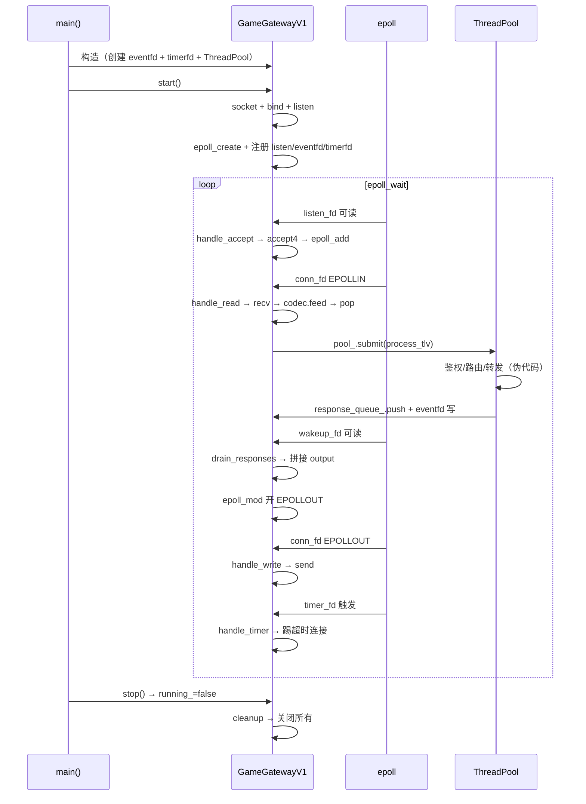
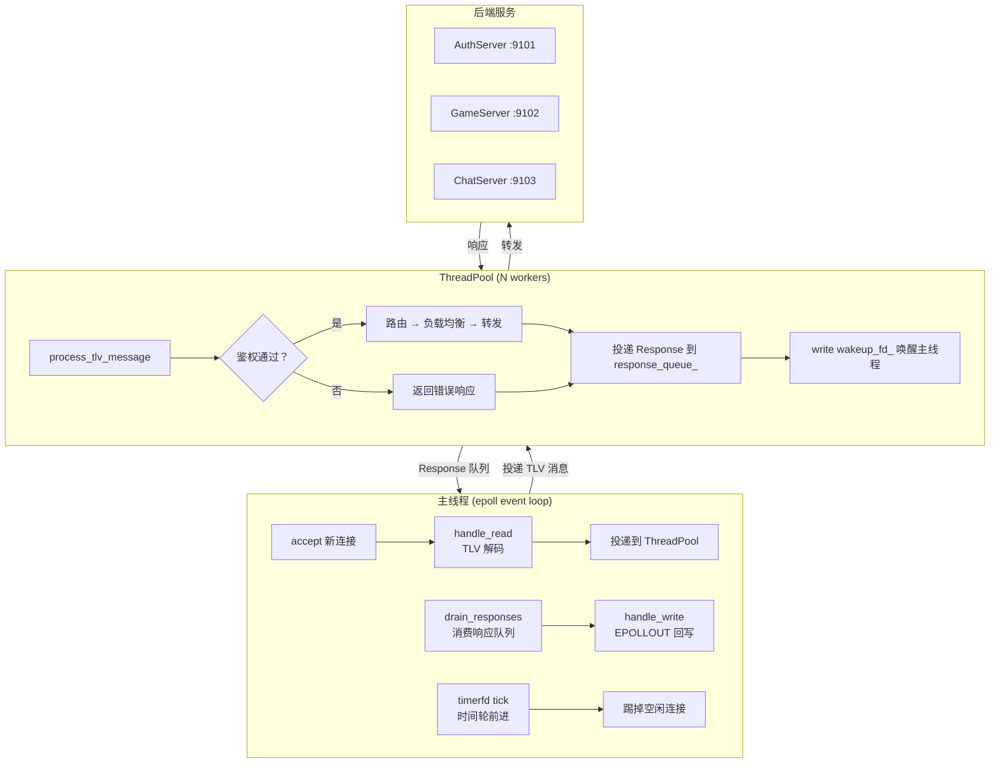
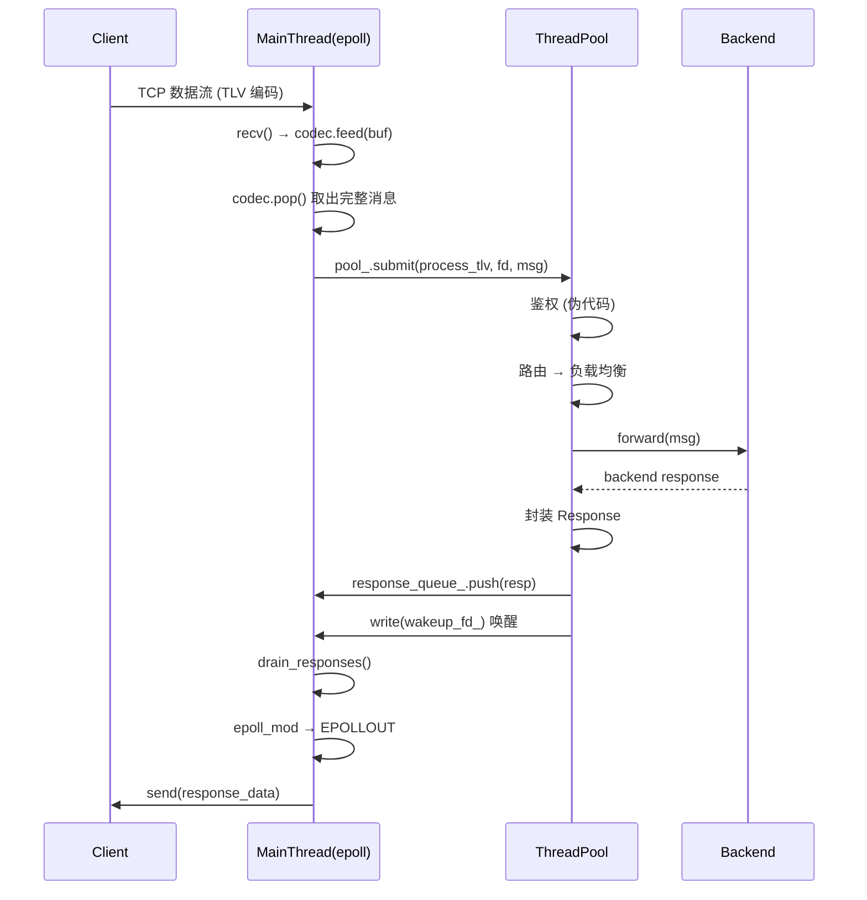
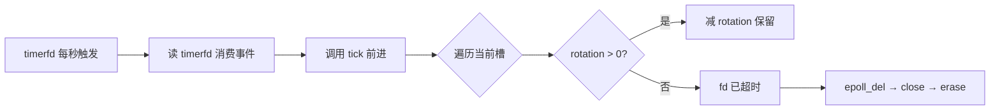
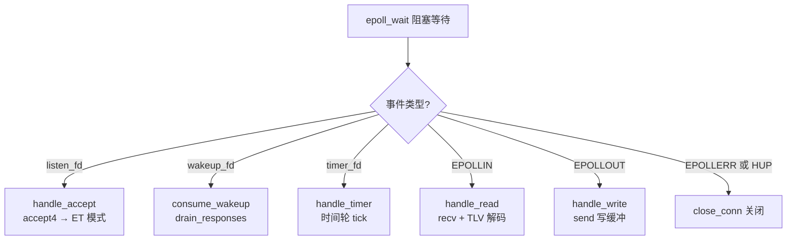

> [!info] 核心概念
> **GameGatewayV1** 是一个教学级游戏网关的完整实现，演示了**真实网关架构**的 7 个核心职责：连接终结 → TLV 粘包拆包 → 鉴权 → 限流 → 路由 → 负载均衡 → 转发。当前源码中 TLV 解码与粘包拆包已完整实现（✓），鉴权/限流/路由/负载均衡/转发以伪代码+注释形式呈现（✗），形成"能跑的教学示例"与"真网关蓝图"的双层结构。

## 文件概览

| 项目 | 内容 |
| --- | --- |
| 文件路径 | `game-server-engine/src/examples/net/easyserver/game_gateway_v1.cpp` |
| 核心类 | `GameGatewayV1`（主网关）、`TimeWheel`（时间轮定时器）、`SPSCQueue`（无锁队列）、`Connection`（连接上下文） |
| 依赖 | `base/thread_pool.hpp`、`base/tlv_codec.hpp`、Linux `epoll`/`eventfd`/`timerfd` |
| 行数 | ~737 行 |
| 构建目标 | `game_gateway_v1` |

## 源码领读：从 main() 逐级深入

### 入口：main() — L707~736

```cpp
int main(int argc, char* argv[]) {
    int port = DEFAULT_PORT;       // 9015
    int workers = DEFAULT_WORKERS; // 4
    int timeout = IDLE_TIMEOUT;    // 30s
    if (argc > 1) port = std::atoi(argv[1]);
    if (argc > 2) workers = std::atoi(argv[2]);
    if (argc > 3) timeout = std::atoi(argv[3]);
    // ...
    GameGatewayV1 server("0.0.0.0", port, workers, timeout);
    server.start();  // ← 阻塞在此，直到 stop() 被调用
    return 0;
}
```

三参数解析后直接构造 + start()，无信号处理（Ctrl+C 直接杀进程，可改进）。

### 构造 GameGatewayV1 — L287~303

构造函数做的 3 件事（逐行看）：

| L#  | 操作                                                | 说明                                     |                            |
| --- | ------------------------------------------------- | -------------------------------------- | -------------------------- |
| 293 | `pool_(workers)`                                  | 创建 ThreadPool，此时 N 个 Worker 线程已启动并等待任务 |                            |
| 296 | `::eventfd(0, EFD_NONBLOCK                        | EFD_CLOEXEC)`                          | 创建 eventfd，用于工作线程→主线程的唤醒通知 |
| 297 | `::timerfd_create(CLOCK_MONOTONIC, TFD_NONBLOCK)` | 创建 timerfd，为时间轮提供 1 秒 tick 时钟源         |                            |

> 💡 两个 fd 加上 listen_fd 和 main_epfd，构成了网关的**四个核心文件描述符**。

### start() 启动流程 — L307~371

#### 第一步：监听 socket 初始化 — L309~324

```cpp
listen_fd_ = ::socket(AF_INET, SOCK_STREAM | SOCK_NONBLOCK, 0);
// SOCK_NONBLOCK：创建即非阻塞，省一次 fcntl
int opt = 1;
::setsockopt(listen_fd_, SOL_SOCKET, SO_REUSEADDR, &opt, sizeof(opt));
// SO_REUSEADDR：端口复用，防止 TIME_WAIT 时 bind 失败
::bind(listen_fd_, (struct sockaddr*)&addr, sizeof(addr));
::listen(listen_fd_, 128);
```

#### 第二步：创建 epoll 实例并注册 — L327~338

```cpp
main_epfd_ = ::epoll_create1(EPOLL_CLOEXEC);
epoll_add(listen_fd_, EPOLLIN | EPOLLET);   // 监听 socket（ET 模式）
epoll_add(wakeup_fd_, EPOLLIN | EPOLLET);   // eventfd 唤醒（ET 模式）
// timerfd 设置为每秒触发一次
itimerspec ts = {{1, 0}, {1, 0}};           // it_interval=1s, it_value=1s
::timerfd_settime(timer_fd_, 0, &ts, nullptr);
epoll_add(timer_fd_, EPOLLIN | EPOLLET);    // 定时器 tick（ET 模式）
```

#### 第三步：事件循环 — L347~369（核心中的核心）

```
epoll_wait 返回后，dispatch 逻辑（L354~368）：

    fd == listen_fd_   → handle_accept()      // 新连接
    fd == wakeup_fd_   → consume_wakeup()       // 消费 eventfd
                          + drain_responses()   // 处理 ThreadPool 返回的响应
    fd == timer_fd_    → handle_timer()         // 时间轮前进
    ev & EPOLLIN       → handle_read(fd)        // 客户端数据到达
    ev & EPOLLOUT      → handle_write(fd)       // 发送缓冲可写
    ev & (ERR|HUP)     → close_conn(fd)         // 异常关闭
```

**关键设计**：主线程只做 IO 和调度，所有业务处理在 ThreadPool 中执行。三种 fd（listen / eventfd / timerfd）+ 两种 IO 事件（IN / OUT）构成了全部的事件源。

### handle_accept() 接受连接 — L403~427

```cpp
void handle_accept() {
    while (true) {
        int fd = ::accept4(listen_fd_, ..., SOCK_NONBLOCK);
        if (fd < 0) {
            if (errno == EAGAIN || errno == EWOULDBLOCK) break;  // 全部 accept 完
            continue;
        }
        // ① TCP_NODELAY：关 Nagle，游戏小包不能等
        setsockopt(fd, IPPROTO_TCP, TCP_NODELAY, ...);
        // ② 注册到 epoll 的 ET 读模式
        epoll_add(fd, EPOLLIN | EPOLLET);
        // ③ 创建 Connection 上下文
        conns_[fd] = make_unique<Connection>();
        // ④ 加入时间轮（超时踢除）
        tw_.add(fd, idle_timeout_);
    }
}
```

**ET 循环**：`accept4` 循环直到 EAGAIN——ET 模式必须把当前批次所有连接全部取出，否则后续新连接不再触发可读事件。

> 💡 **`{}` 作用域锁**：实际代码中 `conns_[fd]` 的写操作被 `{}` + `lock_guard` 包裹（L434~L437），锁释放后才执行 `tw_.add()`。目的有二：
>
> 1. **最小化持锁时间**——`tw_` 是独立的数据结构，不需要 `conns_mutex_` 保护，不应在锁内执行
> 2. **防御性编程**——注意 `conns_mutex_` 的所有使用方（handle_accept/handle_read/handle_write/handle_timer/drain_responses/close_conn）**都在同一个主线程中执行**。工作线程通过 `response_queue_` 通信，从不直接访问 `conns_`。这把锁在当前的单线程 Reactor 模型下是"单人间的门锁"，但它为未来可能的并发改动保留了安全余量。
>
> 对比 `handle_read` 中锁覆盖了整个 `recv` 循环（L448~L478），`handle_accept` 的 `{}` 作用域展示了更精确的锁粒度控制。

> [!tip] **`idle_timeout_` 完整初始化链**
>
> ```text
> IDLE_TIMEOUT(30)                  ← 默认常量（L93）
>   → main() argv[3] 覆盖            ← 命令行参数（L723~L727）
>     → 构造函数参数默认值             ← GameGatewayV1(..., idle_timeout=IDLE_TIMEOUT)（L292）
>       → 初始化列表 idle_timeout_(idle_timeout)（L296）
>         → 成员变量 idle_timeout_    ← 存储为实例成员（L701）
>           → tw_.add(fd, idle_timeout_)  ← accept 时写入时间轮（L438）
>             → TimeWheel::add: ticks=30, rotation=0, ts=cur_slot+30
> ```
>
> 默认值 30 秒，可通过 `./game_gateway_v1 9015 4 60` 覆盖为 60 秒。

### handle_read() 读取 + TLV 解码 — L430~469

```cpp
void handle_read(int fd) {
    // ① 持锁查连接表（conns_mutex_ 粒度问题见「踩坑 1」）
    Connection* conn = conns_[fd].get();
    char buf[BUFFER_SIZE];  // 8192

    while (true) {
        ssize_t n = ::recv(fd, buf, sizeof(buf), 0);
        if (n > 0) {
            // ② 喂给 TLV 解码器
            conn->codec.feed(buf, n);
            // ③ 取出所有完整消息
            while (conn->codec.has_message()) {
                TlvMessage msg = conn->codec.pop();
                tw_.add(fd, idle_timeout_);  // 续期时间轮
                // ④ 投递到 ThreadPool 处理
                pool_.submit([this, fd, msg]() {
                    process_tlv(fd, msg);
                });
            }
        } else if (n == 0) {      // 对端关闭
            peer_closed = true; break;
        } else {
            if (errno == EAGAIN) break;  // 数据读完
            peer_closed = true; break;
        }
    }
}
```

**数据流**：`recv()` → `codec.feed()` → `codec.pop()`（一条完整 TLV 消息）→ `pool_.submit()` 交给工作线程。

### process_tlv() 消息处理（ThreadPool 中执行）— L472~593

```cpp
void process_tlv(int fd, const TlvMessage& msg) {
    // ── 当前行为：教学回退（L558~583）──
    // 直接在 switch 中处理业务：
    switch (msg.type) {
        case TlvType::LOGIN:     // 回显名字
        case TlvType::HEARTBEAT: // 心跳回复
        case TlvType::ECHO:      // 回显数据
        default:                 // 返回错误
    }
    // 处理后投递响应
    Response resp{fd, response};
    while (!response_queue_.push(resp))     // SPSC 入队（忙等）
        std::this_thread::yield();
    ::write(wakeup_fd_, &one, sizeof(one)); // 唤醒主线程
    // ── 真网关应做的 4 步（L474~552 注释伪代码）：──
    // 1. 鉴权 → 2. 路由 → 3. 负载均衡 → 4. 转发
}
```

**两个关键机制**：

| 机制 | 说明 |
| --- | --- |
| **SPSCQueue 入队** | 无锁队列，满时 yield 忙等（容量 256 的限制见「踩坑 4」） |
| **eventfd 唤醒** | 写入 8 字节唤醒主线程 epoll_wait，触发 drain_responses() |

### drain_responses() + handle_write() 回写 — L596~630

drain_responses 在主线程 eventfd 触发时调用（L596~609）：

```cpp
void drain_responses() {
    Response resp;
    while (response_queue_.pop(resp)) {
        std::lock_guard<std::mutex> lock(conns_mutex_);
        auto it = conns_.find(resp.fd);
        if (it == conns_.end()) continue;              // 连接已关闭，丢弃响应
        Connection* conn = it->second.get();
        conn->output.append(resp.data);                // 写入输出缓冲
        epoll_mod(resp.fd, EPOLLIN | EPOLLOUT | EPOLLET);  // 开 EPOLLOUT
    }
}
```

> `find()` 不会自动循环或推进。每调用一次做 O(1) 哈希查找，返回迭代器或 `end()`。`if (it == end()) continue` 处理竞态——从工作线程投递响应到主线程消费之间，连接可能已被 `handle_timer` 或 `close_conn` 关闭。

handle_write 在 EPOLLOUT 事件触发时调用（L612~630）：

```cpp
void handle_write(int fd) {
    ssize_t n = ::send(fd, conn->output.data(), conn->output.size(), 0);
    if (n > 0) {
        conn->output.erase(0, n);          // 擦除已发送部分
        if (conn->output.empty())
            epoll_mod(fd, EPOLLIN | EPOLLET);  // 写完关 EPOLLOUT
    }
}
```

**EPOLLOUT 开关策略**：只在有数据要写时开启，写完后立即关闭（`EPOLLIN | EPOLLET`）。否则 ET 模式下写缓冲一直可写，epoll_wait 会持续空转。

### handle_timer() + TimeWheel 踢超时 — L633~647

```cpp
void handle_timer() {
    [[maybe_unused]] ssize_t n = ::read(timer_fd_, &exp, sizeof(exp));
    //        ↑ C++17 属性：read 返回值不需要检查，但必须赋值以抑制 warn_unused_result
    auto expired = tw_.tick();               // 时间轮前进一格
    for (int fd : expired) {
        epoll_del(fd); conns_.erase(fd); ::close(fd);  // 踢掉
    }
}
```

> `[[maybe_unused]]` 是 C++17 标准属性，等价于传统 `(void)n;` 写法。文件中三处使用：`consume_wakeup` 的 eventfd read（L678）、`process_tlv` 的 eventfd write（L606）、`handle_timer` 的 timerfd read（L648）——这些 fd 的 `read()`/`write()` 返回值不需要业务处理，不抑制会触发 `-Wunused-result` 警告。

时间轮每格 1 秒，60 格一圈。`tick()` 遍历当前槽，`rotation>0` 的减 1 保留，`rotation==0` 的视为超时返回。见 [[5-3 SIGALRM信号高性能定时器——时间轮|5-3 时间轮定时器]]。

> 💡 **timerfd 驱动 vs SIGALRM 驱动**
> 
> 项目中存在两套时间轮实现，驱动方式不同：
> 
> | 维度 | `time_wheel_server.cpp`（SIGALRM 版） | `game_gateway_v1.cpp`（timerfd 版） |
> | --- | --- | --- |
> | 定时器创建 | `alarm(1)` → 内核发 SIGALRM | `timerfd_create()` → 返回 fd |
> | 事件传递 | 信号 → pipe → epoll → 设 timeout 标志 → 延后 tick | timerfd 直接注册到 epoll → dispatch 直达 tick |
> | 重新设时 | 手动 `alarm(1)`（每次 tick 后必须重设） | 自动（`it_interval` 设周期，内核自动重复） |
> | 事件优先级 | I/O 优先，定时延后 | 定时与 I/O 同级 |
> | 信号处理 | 需 sigaction + pipe + 信号处理函数 | 无信号参与 |
> 
> SIGALRM 版路径：`alarm → SIGALRM → sig_handler → write pipe → epoll 读 pipe → timeout=true → tick() + alarm(1)`
> 
> timerfd 版路径：`timerfd_settime → epoll_wait 直接返回 timerfd 可读 → read(timer_fd) → tick()`
> 
> timerfd 版是 Linux 3.0+ 引入 timerfd 后的现代做法，免去了信号处理和 pipe 桥接的复杂度。详见 [[5-3-时间轮vs升序链表-whell_scheduled.hpp|时间轮 vs 升序链表]]。

### close_conn() 关闭连接 — L650~659

```cpp
void close_conn(int fd) {
    tw_.remove(fd);       // 从时间轮移除
    epoll_del(fd);        // 从 epoll 移除
    conns_.erase(fd);     // 删除 Connection
    ::close(fd);          // 关闭 socket
}
```

### stop() + cleanup() 优雅退出 — L374~382, L668~683

```cpp
void stop() {
    running_ = false;
    ::write(wakeup_fd_, &one, sizeof(one));  // 唤醒 epoll_wait 使其退出
}
void cleanup() {
    pool_.stop();              // 停线程池（等待所有任务完成）
    for (auto& [fd, _] : conns_) { close(fd); }  // 关闭所有客户端连接
    ::close(listen_fd_);       // 关闭监听
    ::close(main_epfd_);       // 关闭 epoll
    ::close(wakeup_fd_);       // 关闭 eventfd
    ::close(timer_fd_);        // 关闭 timerfd
}
```

### 执行路径全景图



## 架构位置

该文件位于 `game-server-engine/src/examples/net/easyserver/` 目录，属于**教学示例层**。它在项目中的位置如下：
它在项目架构中的位置参考 [[6-1 高性能服务器框架概述|6-1 高性能服务器框架概述]]。

```
game-server-engine/
├── src/
│   ├── core/          ← 基础 Reactor 框架（Reactor.hpp、EventLoop 等）
│   ├── network/       ← 网络层封装（TcpConnection、Acceptor 等）
│   ├── base/          ← 基础组件（ThreadPool、TlvCodec 等）
│   └── examples/
│       └── net/
│           └── easyserver/
│               ├── multi_reactor_server.cpp    ← 多 Reactor 示例
│               └── game_gateway_v1.cpp         ← 本篇：游戏网关 V1
```

**调用链上下游**：
```
Client (TCP) ←→ GameGatewayV1 (epoll Reactor)
                      │
           ┌──────────┼──────────┐
           ▼          ▼          ▼
     AuthServer   GameServer   ChatServer  ← 后端业务服务
      (:9101)     (:9102)      (:9103)
```

## 关键数据结构

### SPSCQueue — 单生产者单消费者无锁队列

```cpp
template <typename T, size_t Capacity = 256>
class SPSCQueue {
    static_assert((Capacity & (Capacity - 1)) == 0, "容量必须是 2 的幂");
    // head_ 和 tail_ 分离在不同的缓存行（alignas(64)），避免伪共享
    // push() 只写 tail_，pop() 只读 head_，无锁无等待
    // 容量为 2 的幂，取模用位运算 (tail + 1) & (Capacity - 1) 代替 %
};
```

> 💡 **工程权重**：⭐⭐⭐⭐ — 这是 ThreadPool → Main Thread 响应投递的核心通道，性能瓶颈所在。

### TimeWheel — 基于槽位的时间轮

```cpp
class TimeWheel {
    static constexpr int N = 60;       // 60 格，每格 1 秒，一圈 60 秒
    struct Slot {
        int fd;                        // 连接 socket fd
        int rotation;                  // 还需转几圈才超时
        int time_slot;                 // 所在槽位（用于快速删除）
    };
    // slots_[60] : vector<list<Slot>>     — 每个槽是一个链表
    // slot_index_: unordered_map<fd, iterator>  — O(1) 删除
    // cur_slot_  : int                     — 当前槽指针
};
```

### Connection — 连接上下文

```cpp
struct Connection {
    TlvCodec codec;              // 该连接的 TLV 解码器（处理粘包）
    std::string output;          // 待发送的写缓冲区
    bool closed = false;         // 对端是否已关闭
    // 真网关还需：SessionInfo session;         // 缓存认证状态
    //            BackendNode* bound_backend;   // 一致性哈希场景
};
```

### Response — 线程间响应投递

```cpp
struct Response {
    int fd;                      // 目标客户端 fd
    std::vector<uint8_t> data;  // 要发回客户端的响应数据
};
```

### GameGatewayV1 — 核心成员

```cpp
class GameGatewayV1 {
    // ── 网络核心 ──
    int main_epfd_;              // 主 epoll 实例
    int listen_fd_;              // 监听 socket
    int wakeup_fd_;              // eventfd: 工作线程 → 主线程唤醒
    int timer_fd_;               // timerfd: 时间轮定时期

    // ── 并发 ──
    ThreadPool pool_;            // 工作线程池（处理 TLV 消息）
    int worker_count_;           // 工作线程数

    // ── 连接管理 ──
    TimeWheel tw_;               // 时间轮（空闲超时检测）
    std::mutex conns_mutex_;     // 保护 conns_ 的互斥锁
    std::unordered_map<int, std::unique_ptr<Connection>> conns_;  // fd → Connection

    // ── 跨线程通信 ──
    SPSCQueue<Response> response_queue_;  // ThreadPool → 主线程的响应队列

    // ── 配置 ──
    std::string host_;
    int port_;
    int idle_timeout_;
    std::atomic<bool> running_;
};
```

## 核心流程

### 1. 整体架构：主线程 + 工作线程 + 后端 IO 线程



### 2. TLV 解码 → 处理 → 响应时序



### 3. 时间轮踢空闲连接



### 4. 主线程事件循环分派



## API 接口说明

### GameGatewayV1

| 接口 | 签名 | 说明 |
| --- | --- | --- |
| 构造函数 | `GameGatewayV1(host, port, workers=4, idle_timeout=30)` | 创建 eventfd + timerfd，初始化 ThreadPool |
| 启动 | `void start()` | 创建 listen socket → epoll 注册 → 进入事件循环 |
| 停止 | `void stop()` | 设置 `running_=false` → 写 eventfd 唤醒 epoll_wait |
| 接受连接 | `void handle_accept()` | `accept4` 非阻塞循环，设 TCP_NODELAY，加入时间轮 |
| 读取 | `void handle_read(fd)` | `recv` 非阻塞循环 → codec.feed → pop 完整消息 → 提交到线程池 |
| TLV 处理 | `void process_tlv(fd, msg)` | 在线程池中执行：鉴权→路由→负载均衡→转发（当前阶段为教学回退） |
| 消费响应 | `void drain_responses()` | 从 SPSCQueue 弹出 Response → 写入 conn->output → 开 EPOLLOUT |
| 写事件 | `void handle_write(fd)` | `send` 写缓冲 → 写完关 EPOLLOUT |
| 定时器 | `void handle_timer()` | 读 timerfd → 时间轮 tick → 踢掉超时连接 |
| 关闭连接 | `void close_conn(fd)` | 时间轮移除 → epoll_del → close(fd) → erase |
| 清理 | `void cleanup()` | 停线程池 → 关闭所有客户端连接 → 关闭 listen/epoll/eventfd/timerfd |

### TimeWheel

| 接口 | 签名 | 说明 |
| --- | --- | --- |
| 添加 | `void add(fd, timeout_sec)` | 计算 rotation + time_slot，插入对应槽链表 |
| 删除 | `void remove(fd)` | 通过 `slot_index_` O(1) 定位并删除 |
| 前进 | `vector<int> tick()` | 当前槽遍历：rotation>0 减 1，否则返回过期 fd 列表 |

### SPSCQueue

| 接口 | 签名 | 说明 |
| --- | --- | --- |
| 入队 | `bool push(const T&)` | 空间满返回 false，否则写入后 store release |
| 出队 | `bool pop(T&)` | 空返回 false，否则 load acquire 后读取 |

## 设计要点

### 1. 教学回退 vs 真网关的双层结构

这是该文件最独特的设计。源码用**注释伪代码 + 实际代码**双线并进：

- **注释（伪代码）**：展示真网关应有的架构——鉴权、路由表、BackendPool、SessionCache、负载均衡算法
- **实际代码**：当前是一个简化的 TLV 回显/登录服务（switch 语句直接处理业务）

这种结构让初学者先看到"能做啥"，再理解"该做啥"。

### 2. 三线程模型

```
Main Thread (epoll event loop)  ← 只做 IO 和调度
    ↓ 池提交
ThreadPool (N workers)          ← 做协议处理、路由决策
    ↓ 无锁队列
BackendIOWorkers (M epoll)      ← 维护后端连接（伪代码）
```

- 主线程永不阻塞：所有业务处理推到 ThreadPool
- ThreadPool 不直接写客户端 socket：所有响应走无锁队列回到主线程
- 后端 IO 独立：真正的网关会有一组独立的 epoll 管理后端连接

### 3. 基于 eventfd 的线程唤醒

工作线程处理完消息后，不是直接写 socket，而是通过 SPSCQueue 投递 Response，然后写 eventfd 唤醒主线程。这比直接加锁调用 `send()` 更安全——主线程是唯一的写者，避免了 socket 写入的并发竞争。

> [!tip] 已确认：eventfd 累加器不会丢信号
> eventfd 内部是累加计数器（`::write()` 使内核计数递增，而非覆盖）。连续写入 N 次后主线程一次 `read()` 取回累加值 N。同时 `drain_responses()` 循环取空 `response_queue_`——不会丢信号也不会丢消息。
>
> 对比 pipe 方案：eventfd 只需 1 个 fd（pipe 需 2 个），内核实现更轻量（计数器加减，不经过文件系统缓冲区）。

### 4. SPSCQueue 的缓存行对齐

```cpp
alignas(64) std::atomic<size_t> head_;
alignas(64) std::atomic<size_t> tail_;
```

将 `head_` 和 `tail_` 分离到独立的缓存行（64 字节），避免伪共享（False Sharing）。**生产者和消费者在不同核心上运行时，不会因为缓存一致性协议导致性能退化。**

### 5. 时间轮 O(1) 操作

- 添加连接：O(1)，直接定位到目标槽
- 删除连接：O(1)，通过 `slot_index_` 哈希表定位
- 超时检查：O(N) 遍历当前槽，但每槽平均连接数很小（60 槽，每槽几十个连接）

相比升序链表定时器（添加 O(N)），时间轮在大量连接场景下优势明显。

### 6. Connection 中内嵌 TlvCodec

每个连接有独立的 TlvCodec 实例，天然处理了粘包问题——多次 `recv` 的数据喂给 codec，直到取出完整消息。这是**每个连接一个解码器**的模式，而非全局解码。

## 关联笔记

- [[6-multi_reactor服务器-multi_reactor_server.cpp|multi_reactor 服务器实现源码解析]] — 底层 Reactor 事件驱动框架
- [[6-1 高性能服务器框架概述]] — Reactor/Proactor 设计模式对比
- [[6-半同步半反应堆线程池-threadpoll.hpp|半同步半反应堆线程池实现]] — 半同步/半反应堆线程池架构
- [[5-3 SIGALRM信号高性能定时器——时间轮]] — 时间轮定时器（SIGALRM 版）
- [[5-3-时间轮vs升序链表-whell_scheduled.hpp|时间轮 vs 升序链表]] — 时间轮 vs 升序链表对比
- [[5-2 IO复用相关技术]] — select/poll/epoll IO 复用
- [[3-4 epoll笔记]] — epoll 核心流程
- [[A 游戏服务器应该有什么]] — 游戏服务器架构全景
- [[B-socket文件解析-socket.hpp|socket.hpp 文件解析]] — RAII Socket 封装
- [[A Netty的演进]] — Netty IO 模型演进

## ⚠️ 踩坑

### 1. conns_mutex_ 的锁粒度
`handle_read` 和 `handle_write` 都持 `conns_mutex_` 锁，且 `handle_read` 在循环 `recv` 期间持锁。如果某个客户端大量发送数据导致 `recv` 循环持续很久，会阻塞其他连接的处理。真网关应精细锁粒度或采用无锁连接表。

### 2. 写缓冲清空后未关 EPOLLOUT
```cpp
if (out.empty()) {
    epoll_mod(fd, EPOLLIN | EPOLLET);  // ✅ 写完关写
}
```
如果不关 EPOLLOUT，ET 模式下会**每次 epoll_wait 都触发写事件**，空转 CPU。当前实现正确，但需要注意 `epoll_mod` 传参——必须带上 `EPOLLIN`，否则会屏蔽读事件。

### 3. 时间轮删除与迭代的冲突
```cpp
for (auto it = slot.begin(); it != slot.end();) {
    if (it->rotation > 0) {
        --it->rotation;
        ++it;             // ✅ 修改后递增
    } else {
        expired.push_back(it->fd);
        slot_index_.erase(it->fd);
        it = slot.erase(it);  // ✅ erase 返回下一个迭代器
    }
}
```
标准库 `erase` 返回下一个迭代器，直接递增会导致悬空迭代器。当前写法正确。

### 4. SPSCQueue 容量 256 的隐含约束
容量 256 意味着最多缓冲 255 个响应（满一格作区分）。如果 ThreadPool 突发大量响应，`push` 会返回 false，工作线程进入 `std::this_thread::yield()` 忙等。这在峰值流量下会烧 CPU——真网关需用更大的队列或条件变量。

### 5. process_tlv 中的教学回退阻塞线程池
当前 `process_tlv` 的 switch 只做简单的 LOGIN/HEARTBEAT/ECHO 处理。在"真网关"模式下，`process_tlv` 中需要执行 `backend_pool_.forward_auth(msg, callback)` 异步回调——如果这里误用了同步 `send` + `recv` 等待后端响应，会**阻塞整个线程池的工作线程**。

### 6. TCP_NODELAY 关闭 Nagle 算法
`handle_accept` 中设置了 `TCP_NODELAY`，关闭 Nagle 算法。这是因为游戏网关的交互式小包（TLV 消息通常几十字节）不能容忍 Nagle 的延迟发送。但注意：如果后端处理慢导致主线程写入大片数据时，Nagle 的合并反而能减少小包数量——所以在某些场景需要权衡。
