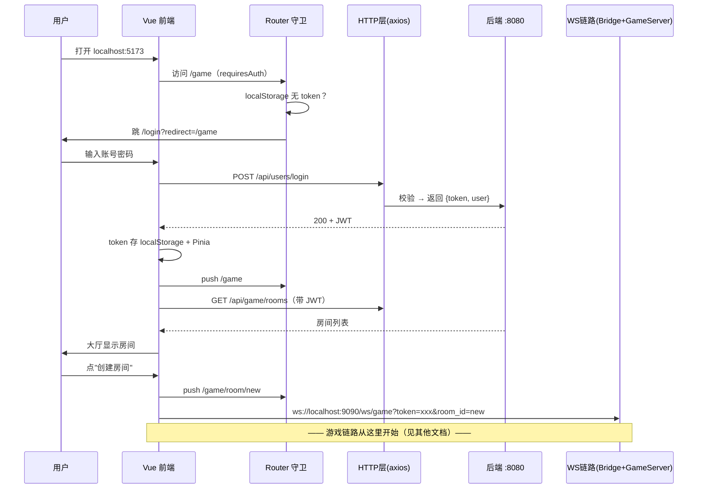

> [!info] 一句话
> 把"打开浏览器 → 登录 → 大厅 → 进入游戏房间"这条前端入口链路拆开讲清楚，补齐之前游戏链路文档缺失的"进入游戏之前"的部分。

## 为什么需要这篇

已有的全链路文档都从 `GameRoom.vue` 开始（已经进房了）。但用户首次访问网站的流程是：

```
地址栏输入 localhost:5173
  → Home.vue 首页
  → 点登录 → Login.vue
  → 输账号密码 → JWT 存 localStorage
  → 跳转 /game → GameLobby.vue 大厅
  → 创建房间 → 跳 /game/room/new → GameRoom.vue（游戏链路开始）
```

这篇文档覆盖 `GameRoom.vue` 之前的所有环节。

## 涉及文件

| 文件 | 职责 |
|------|------|
| `src/main.js` | Vue 应用入口，装配 Pinia + Router + Naive UI |
| `src/router/index.js` | 路由表 + 登录守卫 |
| `src/stores/user.js` | 用户认证状态（JWT 存 localStorage）|
| `src/services/api.js` | axios HTTP 层（拦截器自动带 JWT）|
| `src/views/Login.vue` | 登录表单页 |
| `src/views/GameLobby.vue` | 游戏大厅页 |
| `src/views/GameRoom.vue` | 游戏房间页（已另有文档）|

## 源码领读

### 1. main.js — 应用装配

```javascript
import { createApp } from 'vue'
import { createPinia } from 'pinia'
import naive from 'naive-ui'
import App from './App.vue'
import router from './router'

const app = createApp(App)
app.use(createPinia())   // 全局状态管理
app.use(router)          // 路由
app.use(naive)           // Naive UI 组件库
app.mount('#app')
```

三个核心依赖：
- **Pinia**：全局状态（user store、game store）
- **vue-router**：页面路由
- **naive-ui**：Vue 3 组件库（按钮、表单、卡片等）

### 2. router/index.js — 路由表与守卫

```javascript
const routes = [
  { path: '/',           component: () => import('@/views/Home.vue') },
  { path: '/login',      component: () => import('@/views/Login.vue') },
  { path: '/game',       component: () => import('@/views/GameLobby.vue'),
    meta: { requiresAuth: true } },
  { path: '/game/room/:id', component: () => import('@/views/GameRoom.vue'),
    meta: { requiresAuth: true } },
  // ... 博客、个人中心、管理后台
]
```

> [!tip] 路由懒加载
> `() => import(...)` 是动态导入——页面按需加载，首次打开网站不会下载所有页面的 JS。这是 Vue Router 的标准优化。

**路由守卫**（登录检查）：

```javascript
router.beforeEach((to, from, next) => {
  if (to.meta.requiresAuth) {        // 页面标记了 requiresAuth
    const token = localStorage.getItem('token')
    if (!token) {
      next({ name: 'login', query: { redirect: to.fullPath } })
      // 未登录 → 跳登录页，并记录要回跳的地址
      return
    }
  }
  next()
})
```

关键：**守卫读的是 localStorage 的 token**，不是 Pinia store。原因：刷新页面时 Pinia 状态会清空，但 localStorage 持久化——从 localStorage 恢复登录态。

### 3. stores/user.js — 用户认证状态

```javascript
export const useUserStore = defineStore('user', () => {
  // 初始化时从 localStorage 恢复
  const token = ref(localStorage.getItem('token') || '')
  const user = ref(JSON.parse(localStorage.getItem('user') || 'null'))

  const isLoggedIn = computed(() => !!token.value)
  const isAdmin = computed(() => user.value?.role === 'admin')

  async function login(credentials) {
    const res = await userApi.login(credentials)
    token.value = res.data.token
    user.value = res.data.user
    // 同步到 localStorage（刷新不丢）
    localStorage.setItem('token', res.data.token)
    localStorage.setItem('user', JSON.stringify(res.data.user))
    return res.data
  }

  function clearAuth() {
    token.value = ''
    user.value = null
    localStorage.removeItem('token')
    localStorage.removeItem('user')
  }
})
```

> [!tip] 双份存储的权衡
> token 同时存在 Pinia（内存，供组件响应式读取）和 localStorage（磁盘，刷新后恢复）。**localStorage 是唯一事实源**，Pinia 只是它的内存缓存。
>
> 代价：localStorage 存 token 有 XSS 风险。工业级可用 httpOnly cookie 替代，但纯前端项目用 localStorage 是常见简化。

### 4. services/api.js — HTTP 拦截层

```javascript
const http = axios.create({
  baseURL: '/api',       // 走 Vite 代理 → 后端 :8080
  timeout: 10000,
})

// 请求拦截：自动附加 JWT
http.interceptors.request.use(config => {
  const token = localStorage.getItem('token')
  if (token) config.headers.Authorization = `Bearer ${token}`
  return config
})

// 响应拦截：401 自动跳登录
http.interceptors.response.use(
  res => res,
  error => {
    if (error.response?.status === 401) {
      localStorage.removeItem('token')
      localStorage.removeItem('user')
      window.location.href = '/login'
    }
    return Promise.reject(error)
  }
)
```

> [!tip] 为什么用拦截器而非每个请求手写 header
> JWT 认证是**横切关注点**（cross-cutting concern）——每个请求都要带，但不属于任何具体 API。拦截器把"带 token"和"401 处理"集中在一处，业务代码不用关心认证细节。

**API 分组**：

```javascript
export const userApi = {
  register(data) { return http.post('/users/register', data) },
  login(data)    { return http.post('/users/login', data) },
  getMe()        { return http.get('/users/me') },
  updateMe(data) { return http.put('/users/me', data) }
}
// blogApi / adminApi / gameApi 同模式
```

### 5. Login.vue — 登录页

```vue
<script setup>
async function handleLogin() {
  loading.value = true
  error.value = ''
  try {
    await userStore.login(form)              // → api.js → 后端 :8080
    message.success('登录成功')
    const redirect = route.query.redirect || '/'   // 取守卫记录的跳转地址
    router.push(redirect)
  } catch (e) {
    error.value = e.response?.data?.error || '登录失败'
  } finally {
    loading.value = false
  }
}
</script>
```

**完整登录时序**：

```
Login.vue handleLogin
  → userStore.login(form)
    → userApi.login → axios POST /api/users/login
      → Vite 代理 /api → 后端 :8080
      → 后端校验账号密码 → 返回 { token, user }
    → token 存 localStorage + Pinia
  → router.push(redirect)  ← 守卫记录的地址，通常是 /game
```

### 6. GameLobby.vue — 游戏大厅

```vue
<script setup>
const rooms = ref([])
const error = ref('')

onMounted(async () => {
  try {
    await gameStore.fetchRooms()      // → gameApi.listRooms() → GET /api/game/rooms
    rooms.value = gameStore.rooms
  } catch (e) {
    error.value = '加载房间列表失败'
  }
})

function handleCreateRoom() {
  router.push('/game/room/new')     // 创建房间 → 进游戏房间
}
function joinRoom(roomId) {
  router.push('/game/room/' + roomId)  // 加入房间
}
</script>
```

模板按 `rooms.length` 分两种状态：`0` → 显示"暂无房间，创建一个吧！"空态；非 0 → 遍历 `n-list` 渲染房间卡片（人数 `players/max_players`、状态 tag `PLAYING`/等待中、加入按钮）。

> [!warning] 踩坑（已修复）：`gameStore.fetchRooms` 缺失
> 曾有一段时期 `GameLobby.vue` 调用的 `gameStore.fetchRooms()` 和 `gameStore.rooms` 在 game store 中**不存在** → 打开 `/game` 大厅页报 `fetchRooms is not a function`，房间列表永远为空。
>
> **已修复**（2026-07-31）：`stores/game.js` 补齐 `fetchRooms`（调 `gameApi.listRooms()`）和 `rooms` 状态。
>
> **遗留（后端待办，非前端 bug）**：后端 `GET /api/game/rooms` 仍是占位实现，返回 `{"rooms":[],"message":"房间列表待实现"}` → 大厅现在正常加载但永远显示"暂无房间"。

## 前端双通道架构

这个网站的通信有**两条独立的通道**：

```
通道 A：HTTP（axios）—— 登录、注册、房间列表、博客 CRUD
  路径：浏览器 → /api → Vite 代理 → 后端 :8080
  认证：JWT Bearer token（localStorage）
  特点：请求-响应，一次性

通道 B：WebSocket —— 游戏实时通信
  路径：浏览器 → ws://localhost:9090 → Bridge → GameServer :9003
  认证：URL query 带 token（?token=xxx&room_id=new）
  特点：长连接，双向推送，帧同步
```

两条通道的登录态是**独立的**：
- HTTP 用 JWT（`Authorization: Bearer xxx`）
- WS 用 URL query（`?token=xxx`）

> [!tip] 为什么 WS 用 query 而不用 header
> 浏览器 WebSocket API 无法自定义 HTTP 请求头（握手时）。所以 WS 认证要么放 URL query，要么在握手后发第一条消息带 token。本项目用 query——简单但 token 会出现在访问日志里，工业级应改为"握手后第一条消息认证"。

## 完整网站链路图



## 关联笔记

- [[前端WS客户端-ws.js]] — 通道 B 的客户端封装
- [[前端游戏状态-game.js]] — 通道 B 的状态管理
- [[前端3D场景-GameRoom.vue]] — 通道 B 的渲染端
- [[游戏主循环-game_server.hpp]] — 通道 B 的服务端
- [[1-MOC 全链路总览-索引]] — 全链路索引

## Vue3 概念补课

> [!tip] 0 前端基础？从这篇开始
> 这篇涉及的 Vue3 概念最少（main.js 装配、路由守卫、store、模板），按需跳读：
> - 主入口 `app.use()` 是什么 → [[1-VUE3认知地图-索引]]
> - 路由表与守卫 → [[7-Vue3路由与导航守卫]]
> - user store（localStorage 双份存储）→ [[6-Vue3状态管理-Pinia]]
> - Login/GameLobby 模板语法 → [[4-Vue3组件与模板语法]]
> - 读完本篇可无缝衔接 [[8-Vue3实战-读懂前端源码]]

## ⚠️ 踩坑/待办

### 已确认的坑

1. **`GameLobby.vue` 调用不存在的 `gameStore.fetchRooms()`**（已修复）— 原因：`stores/game.js` 重构时删掉了房间列表相关代码，但 GameLobby 没同步更新。已补 `fetchRooms` + `rooms`。
2. **后端 `/api/game/rooms` 为占位实现**（待办）— 返回空数组 + "房间列表待实现"，大厅房间列表永远为空。真正的房间数据在 GameServer `:9003` 的 `RoomManager` 里，后端尚未桥接。

### 【待确认】的问题

- HTTP 通道的 token 存 localStorage，WS 通道的 token 走 URL query——如果 token 过期，HTTP 会自动 401 跳登录，但 WS 通道没有任何 401 处理。WS 连接若因 token 无效被拒，前端如何感知？
- `/game/room/new` 的 `room_id=new` 只是 URL 占位，真实房间号在 `GameRoom.vue` 里通过 `gameStore.roomId` watch 跳转获得。如果 GameServer 返回 `room_id` 的时机与路由跳转有竞态会怎样？
